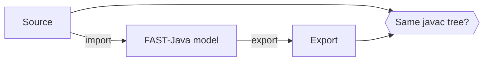
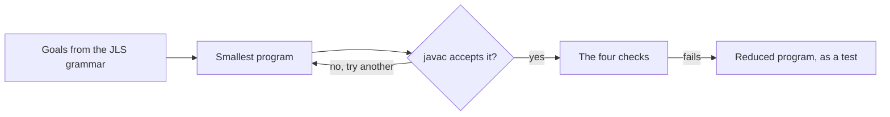

[FAST-Java](https://github.com/moosetechnology/FAST-JAVA) is the Moose metamodel of Java syntax trees. An importer builds a model from source with the Java parser of [SmaCC](https://github.com/j-brant/SmaCC), and an exporter writes a model back as source. Analyses, rewriting rules and interpreters built on FAST-Java can only be as right as that model.

This autumn we set out to answer one question: does FAST-Java handle all of Java? Unit tests and sample projects only show that it handles what they contain. This post is about how we answered the question instead, and what we fixed along the way. We did it with Claude, Anthropic's AI model, and the [last section](#how-we-worked) says how. A [second post](/posts/fast-java-v5/) presents FAST-Java v5, which grew out of this work.

## What we check

FAST-Java is syntactic: it models what a program writes, not what its names resolve to. Compliance is therefore about the grammar and about what the model keeps of it. Every program that javac's parser accepts makes a round trip through FAST-Java:



On the way, we check four things:

1. **Import.** SmaCC parses the program and the importer builds one compilation unit, with no error.
2. **Positions.** Every entity spans whole tokens of the source.
3. **Meaning.** The export has the same javac syntax tree as the program, so the import lost nothing the program means.
4. **Comments.** Each comment is imported once, attached to code, and written back by the export.

The other direction matters too: the parser should refuse what Java does not allow, rather than build a tree no Java program has.

Writing a source back exactly as it was is not on the list. Redundant parentheses, `x ->` against `(x) ->`, or `@A()` against `@A` are style, and the model does not keep them. The meaning check compares trees, not text.

## javac decides

Reading the JLS and writing probes by hand, we twice recorded a gap in the parser that turned out not to be Java at all. Since then, every probe goes through javac before it counts, and javac decides every check above. It says which programs are valid. Its parser's trees, compared with parentheses skipped, say whether two programs mean the same.

javac runs as a small Java server that Pharo queries over HTTP. Thousands of checks then pay for a single JVM start-up.

## The whole JDK as a corpus

The sources of JDK 8 and JDK 25, every module included, hold 32,999 files written by people who know Java well. We import each one, run the checks, export it and compare. We call this run the census.

The census began with `java.base` alone, a fifth of JDK 25. Widening it to both whole JDKs found a grammar gap and several model defects that no file of `java.base` exercises. One example: `outer.new Inner() { }` came back as `new Inner() { }`, which instantiates a different type.

How the comparison is made matters as much as the corpus. We first compared the token streams of the source and of its export. Parentheses were left out, since the exporter writes its own from operator precedence. That looked safe, and it was not. When javac compared the trees instead, nearly a thousand JDK files turned out to export a different program:

| Source | Exported as |
|---|---|
| `a - (b + c)` | `a - b + c` |
| `((T[]) o)[0]` | `(T[]) o[0]` |
| `record R(int a) { R { } }` | `record R(int a) { R() { } }` |

The last one is a different constructor, and a token comparison sees it as one more pair of parentheses. The census has compared javac trees ever since.

Comments got the same treatment last. Each comment the file writes must be imported once, belong to code, and come back once from the export. That check caught exports that wrote a comment twice, or lost one. In one case a line comment after the update of a `for` swallowed the parenthesis closing the header:

```java
for (int i = 0; i < n;
     i++ // next
) { }
```

With v4.6.0 and v5.0.0, every file passes every check:

| Corpus | Files | Pass every check |
|---|---|---|
| JDK 8 sources | 17,631 | 17,631 |
| JDK 25 sources | 15,368 | 15,368 |

## Fixing the grammar upstream

FAST-Java reads Java through SmaCC's Java grammar, which John Brant maintains. From October 19 to November 19, thirteen pull requests to SmaCC brought that grammar in line with the JLS. Each fix followed the same steps:

1. Find a refusal.
2. Trace it to the JLS production that allows the program.
3. Confirm with javac that the program is Java.
4. Change the grammar.
5. Check that the whole JDK still parses.

Among what the grammar reads now:

| JLS | Construct | Example |
|---|---|---|
| 7.3 | Compact compilation unit | a file holding only `void main() { }` |
| 7.5.5 | Module import | `import module java.base;` |
| 8.8.7 | Statements before `super(...)` | `C(int x) { check(x); super(x); }` |
| 14.30.1 | Record pattern | `o instanceof Point(var x, var y)` |
| 14.11.1 | `null` with `default` | `case null, default ->` |
| 4.11 | Type annotations | `java.util.@A List`, `String @A []`, `(@A Object) o` |
| 3.10.2 | Hexadecimal float | `0x1p-24f` |
| 3.10.7 | Space escape | `"\s"` |

Some fixes go the other way. The grammar accepted `yield;`, `sealed class A permits B<T>` and `0x1.8`, and javac refuses all three.

Unicode escapes took more than a grammar rule. JLS 3.3 translates `\uXXXX` before anything else reads the text, so an escape can change how the rest is read:

```java
char c = '\u005cn';   // the escape writes a backslash: c is a newline
```

No token regular expression can express that. The scanner now reads through a stream that translates escapes, and every token still knows its position in the text as written.

A grammar change can break its consumers without any parse error, if a production starts building a different node class. So the later changes also compared the parse trees of the files that parsed before them, node by node, and kept them identical. Where an earlier change had to reshape a node, as for patterns, the old accessors stayed as deprecated readers of the new ones. Many thanks to John Brant for reviewing and merging all of them.

## Testing from the grammar itself

The JDK is a large corpus but a biased one. It writes what its authors needed, and newer features such as record patterns barely appear in it. No corpus can show what it does not contain. The last step therefore tests FAST-Java against the grammar of the JLS itself.



- **Grammar.** Each JLS edition is published as HTML, with every production marked up. A reader takes chapters 3 to 19 of an edition and builds its grammar. Chapter 19 is not enough on its own: it is a summary, and SE 25's names productions it does not define.
- **Goals.** From that grammar, a list of what some program must contain, taken from the grammar-testing literature:
  - every alternative of every production (Purdom's coverage);
  - every alternative at every place its production is used (Lämmel's context-dependent coverage);
  - every repetition written 0, 1 and 2 times;
  - every option taken and left out.

  Two kinds of goals cover what the grammar says only in prose: samples, such as a non-ASCII letter in an identifier, and every contextual keyword used as a name.
- **Programs.** For each goal not yet covered, a generator builds the smallest program that holds it. When javac refuses that program, the generator tries others:
  - the goal reached from another place;
  - one more choice nearby, like the `sealed` that a `permits` clause needs;
  - the goal inside an enclosing construct, like a switch expression around a `yield`.

  For SE 25, about 1,200 programs cover 2,786 goals.
- **Checks.** The four checks above, on every program javac accepts. For the comment check, a comment is written before every token.
- **Reduction.** A failing program is shrunk on its derivation tree. Each step is still a program of the grammar, still accepted by javac, and still failing the same way. Failures are grouped by cause, and the reduced program of each cause becomes a FAST-Java test.

Here is what the generator writes for the production of a wildcard:

```text
Wildcard:
    {Annotation} ? [WildcardBounds]
```

| Goal | Program |
|---|---|
| No annotation, no bounds | `a < ? > a ( ) ;` |
| Bounds with `extends` | `a < ? extends a > a ( ) ;` |
| Bounds with `super` | `a < ? super a > a ( ) ;` |
| One annotation | `a < @ a ? > a ( ) ;` |
| Two annotations | `a < @ a @ a ( ) ? > a ( ) ;` |
| An annotation with a single element | `a < @ a ( 0 ) ? > a ( ) ;` |

Each program is a whole compact compilation unit, declaring a method whose return type writes the wildcard. Such programs mean nothing, but javac's parser accepts every one.

The first runs found five more places where the grammar refused Java, now fixed in SmaCC:

```java
Object o = (@A String[]) null;   // an annotated array type
<T> @A void m() { }              // annotations after type parameters
Inner i = a.new @A Inner();      // an annotated qualified creation
int seven = 0_7;                 // underscores after an octal 0
catch (@A E | @B F e) { }        // annotations in a multi-catch
```

They also found what FAST-Java dropped. The report gives each failure group its reduced program and what the export wrote, as for these two:

| Program | Exported as | Lost |
|---|---|---|
| `enum a { a { } }` | `enum a { a }` | the body that makes `a` an anonymous class |
| `enum a { a ( new byte @ a [ this ] ) }` | `enum a { a(new byte[this]) }` | the annotation on the brackets |

Every fix shipped in v4.6.0. On v4.6.0 and v5.0.0, nearly every goal passes, with the same results:

| JLS | Goals | Pass | Fail | Refused by javac |
|---|---|---|---|---|
| SE 8 | 2,290 | 2,278 | 2 | 10 |
| SE 17 | 2,658 | 2,651 | 2 | 5 |
| SE 21 | 2,714 | 2,707 | 2 | 5 |
| SE 25 | 2,786 | 2,778 | 2 | 6 |

The goals javac refuses are places where the grammar allows more than the language: `final final int a`, for example, which the JLS rules out in prose. The two that fail are the `default` modifier of an interface method. The generator writes it only on a method without a body, which javac's parser accepts and its compiler refuses. SmaCC refuses it as well. A default method with a body imports fine, and the JDK is full of them.

## What it cannot tell

- **Rules javac checks after parsing.** The oracle only parses. A program such as `@A(this.x)` is syntactically fine and still not Java, because an annotation needs a constant. The generator writes a constant there for that reason, but other rules of that kind remain, so every failure group needs that question asked.
- **Combinations beyond pairs.** Context-dependent coverage pairs each alternative with each place it is used, not with everything around it. Corpora stay useful for what real code combines.
- **Preview features.** Their grammar enters the JLS only once they are final.

## When the next Java comes out

The grammar of each edition is data, so a new edition starts with a diff against the previous one. The productions it adds or changes get tested first, then everything is run again. SE 26 writes the same grammar as SE 25, so it needed nothing new.

The tool is [grammar-coverage](https://github.com/Evref-BL/grammar-coverage), a set of Pharo packages and a single-file javac server. Its README says how to run it on a JLS edition or on a corpus. Its core knows no language: Java supplies the grammar reader, the samples, javac and the FAST-Java checks. Another FAST language would supply its own.

## How we worked

We did this work with Claude, Anthropic's AI model, through Claude Code. Claude worked in live Pharo images through an MCP server, and in headless images for the long runs. It wrote most of the code: the SmaCC grammar changes, the FAST-Java fixes and their tests, and grammar-coverage. It also ran the censuses, traced failures back to the JLS, and drafted the pull requests, the commit messages and these two posts.

I set the direction, reviewed every change before merging it, and made the design calls. Several of them overruled a first proposal:

- Claude first made the export token-exact, with model properties recording redundant parentheses. I turned those pull requests down: the model keeps what changes meaning, not how code is spelled.
- When it gave a package declaration the trait that holds modifiers, I asked why a package should be able to hold `public`. That question became the rule that annotations are not modifiers.
- Its first fix for comments written twice kept a record of the comments already written. I asked for a fix without that state, and now each node writes its own comments and no other.
- Fixes went to v4 first, because it was the version in production, and were then ported to v5.

The oracles mattered as much as the reviews. The two probes recorded as parser gaps that were not Java were Claude's, and javac caught them. Twice, a change to the v5 metamodel passed every test and broke more than a thousand JDK files, and the census caught it. An agent writes a fix quickly; javac, the JDK and the grammar say whether the fix is right.
