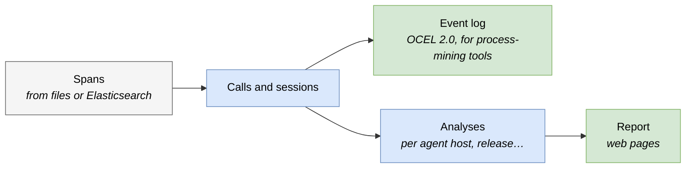
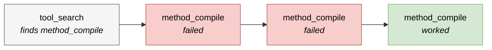
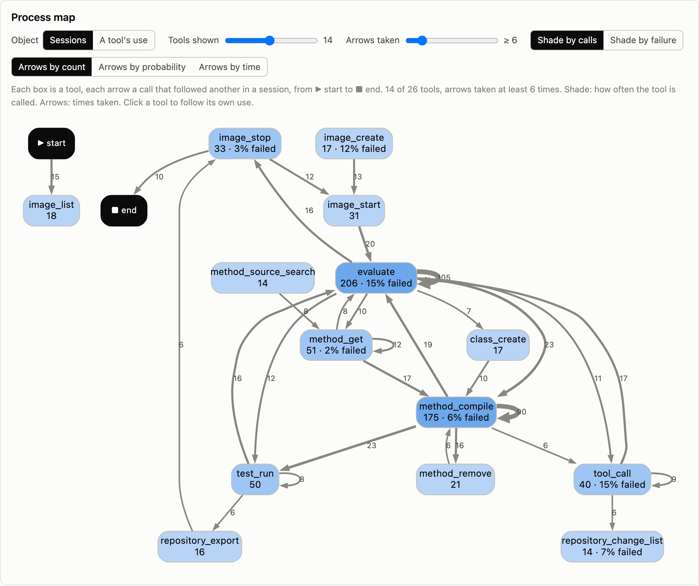
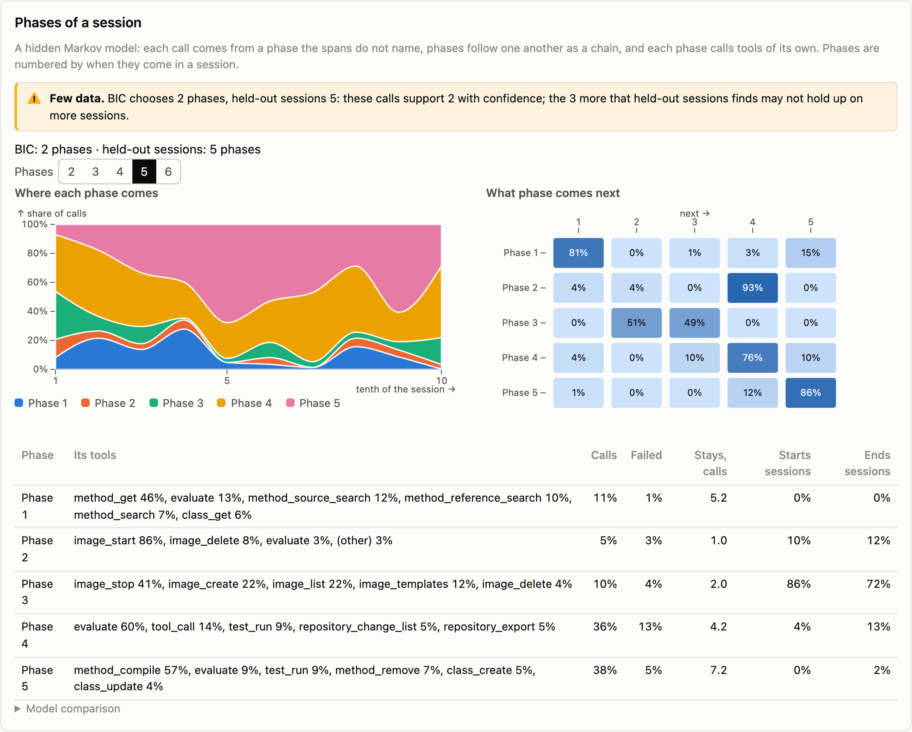
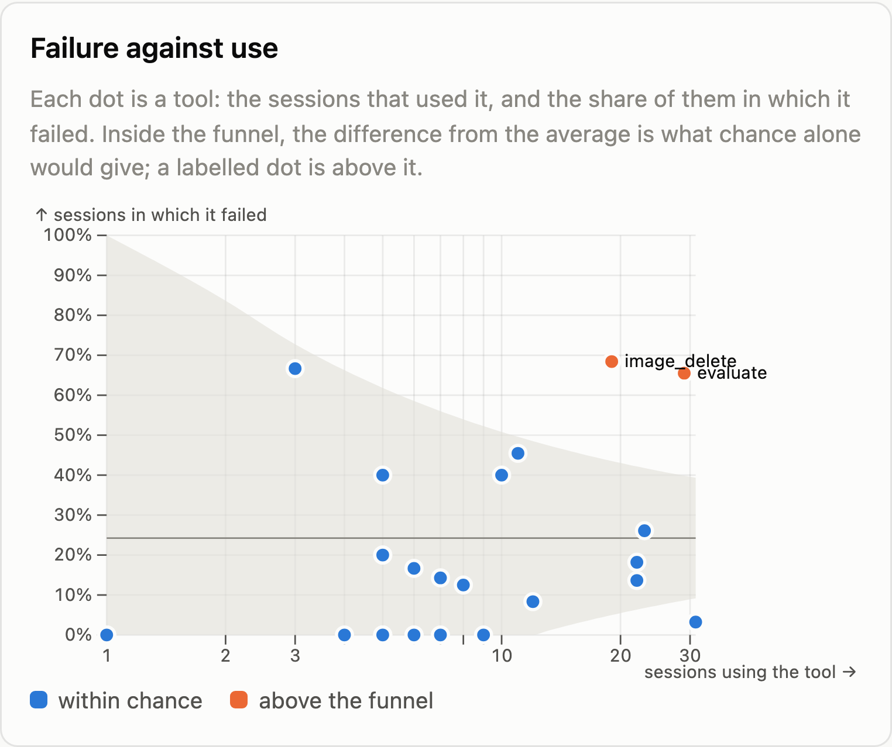

The [previous post](/posts/pharo-tools-observability/) showed what Pharo MCP and PLexus can record about each tool call an agent makes. One trace answers questions about one call: how long it took, and how it failed. The questions that make the tools better are about many calls. Which tools do agents struggle with? What do they do after a failure? Do they find the tool they need? Did the last release make any of it better?

[pharo-agent-analytics](https://github.com/Evref-BL/pharo-agent-analytics) answers them from the spans. It reads the spans from files or from Elasticsearch, rebuilds the calls and the sessions, writes them as an object-centric event log, runs its analyses, and draws a report that you open in a browser. It is open source, under the Apache-2.0 licence. It works on your own spans, and on the spans of many people collected in one place.

This post explains how it reads the agents' work, the research it builds on, and how it keeps its numbers honest.

## From spans to a report



One tool call leaves up to three spans, as the [previous post](/posts/pharo-tools-observability/#what-the-tools-record) shows. pharo-agent-analytics joins them into one **call**.

A call **failed** when the agent did not get what it asked for. A server does not count a request it refused as its own error, as the [conventions for MCP](/posts/pharo-tools-observability/#what-our-tools-follow) ask [@otel-genai-mcp], but pharo-agent-analytics takes the agent's side: a refused call counts as a failed call.

A **session** is the calls of one agent's work. It ends after 30 minutes without a call. Inside a session, the calls are ordered by the time they started.

## Why an object-centric event log

[Process mining](https://en.wikipedia.org/wiki/Process_mining) finds out how a process really runs from an *event log*: a list of events, each with a time and the case it belongs to, such as one order in a shop. But a tool call belongs to several things at once: its session, the tool it calls, the tools a search found, the parts of its arguments that broke the schema, the release that answered it. If each call gets a single case, the log becomes wrong. With the tool as the case, one search that found three tools becomes three events: van der Aalst calls this *convergence*. With the session as the case, the calls to all the tools mix into one sequence, and calls about different things look like a loop: this is *divergence* [@vanderaalst2019]. An *object-centric* event log keeps all these relations instead.

[OCEL 2.0](https://www.ocel-standard.org/), the standard for object-centric event logs, links each event to any number of objects, and says what each link means [@berti2024]. pharo-agent-analytics writes the calls in OCEL 2.0, as SQLite and JSON files, which process-mining tools such as [pm4py](https://processintelligence.solutions/pm4py) can read. Its objects are the session, the tool, the agent host, the release, the parts of a tool's input, and, when the spans have them, the agent host's turn, the agent and the model.

One object is our own: the **tool use**, which is one tool as one session used it. Following a tool across all sessions would mix the work of agents that never worked together. A session and a tool, taken together, have a history of their own, which event knowledge graphs call a *derived entity* [@esser2021]:



Process mining is a new way to look at agents. Fournier, Limonad and David use it, with causal discovery, on the runs of agents, to help developers see how the behaviour of their agents changes from one run to the next [@fournier2025]. Liu et al. draw 4,000 runs of the coding agents [SWE-agent](https://swe-agent.com/) and [OpenHands](https://github.com/OpenHands/OpenHands) as graphs: the runs that solved their issue often went from finding the code, to changing it, to checking the change, while the others went back and forth without order [@liu2025]. These works look at the agent's side of the work. pharo-agent-analytics looks at the tools' side, from the spans that any MCP server following the conventions can send.

## What it answers

Each analysis is made for all calls, and again for each agent host, each release of MCP and PLexus, each Pharo version and each operating system. To compare two releases, you choose them in the report.

- **Where agents struggle.** Which tools fail more often than how much they are used explains, how each tool fails, and where the arguments break a tool's schema: which tool, which part of its input, which rule. Also the names of arguments that agents give to a tool that does not have them.
- **How they recover.** What an agent does after a failure: the same call again, other arguments, another tool, a search, `evaluate`, or the end of the session; then how many calls it takes until the tool works. The authors of SWE-agent measured this for file edits: an edit worked in the end 90.5% of the time, but only 57.2% of the time after one failed edit [@yang2024]. The real cost of a tool's errors is in what happens after them.
- **How they find their tools.** Whether a search leads to a call of a tool it found, and what comes before a call to `evaluate`, the tool that agents use when no other tool fits.
- **How the work flows.** A process map of which call follows which; the most common whole sessions; pairs of calls that follow each other more often than chance would explain, which may show that a tool or a richer answer is missing; and the path from compiling a method to passing tests.
- **Where the time goes.** The time a tool takes, compared with the time the agent takes after the tool's answer, and the calls that the model asked for together, in one answer.

The figures in this post come from a report on 774 calls in 22 sessions. The process map follows the calls from the start of a session to its end. Agents call `evaluate` the most, often many times in a row, and they compile methods in long runs too:



After a failure, the report follows each failed call to what the agent did next, then to whether the tool worked later in the session. Of the 55 failed calls, the agent most often made the same call again, and the tool worked later for 52:


## Markov models

A process map counts which call follows which. It is a first-order [Markov chain](https://en.wikipedia.org/wiki/Markov_chain): it assumes that the next call depends only on the call just before. pharo-agent-analytics says so, and tests that assumption:

- **How far back the next call looks.** Chains that look back 0 to 3 calls, compared with the usual statistical criteria (likelihood ratio, [AIC](https://en.wikipedia.org/wiki/Akaike_information_criterion), [BIC](https://en.wikipedia.org/wiki/Bayesian_information_criterion)) and by how well each one predicts sessions it has not seen, as Singer et al. did for people browsing the web [@singer2014].
- **After a failure.** A chain over each tool and whether it worked or failed, which stops when the tool works or when the session ends. It gives the chance that a failed tool works before the session ends, and how many calls that takes [@grinstead1997, ch. 11]. Compared with what really happened, it shows when more than the last call matters.
- **Phases.** A [hidden Markov model](https://en.wikipedia.org/wiki/Hidden_Markov_model) finds phases in the sessions from the tools called, between 1 and 6 of them [@rabiner1989]. BIC and sessions kept apart for testing choose how many [@celeux2008]. The spans do not name the phases: the report shows which tools each phase uses, and when it comes in a session.

Here, BIC chooses two phases and the sessions kept apart choose five. Named from their tools, the five phases read clearly: one reads code, one starts images, one manages them, one runs code with `evaluate` and tests, and one compiles methods.



## Keeping the numbers honest

A number here shows where to look; it does not decide anything. The spans say where agents struggle and how they recover, but rarely why: for that, you need the agents' conversations. So each number comes with what keeps it from misleading:

- **Sessions, not calls.** The calls of one session are not independent: an agent that retries the same call forty times is one agent, not forty. Rates are counted per session, with [Wilson intervals](https://en.wikipedia.org/wiki/Binomial_proportion_confidence_interval#Wilson_score_interval), which stay correct on small counts, where the usual interval does not [@brown2001].
- **No ranking.** Tools are compared on a funnel plot: the failure rate of each tool against how much it was used, with the limits that chance alone could reach [@spiegelhalter2005]. A tool used twice that failed once is not the worst tool.
- **Competing outcomes.** A session can end before the failed tool works. If those sessions only counted as unfinished, recovery would look better than it is. So the end of the session is treated as a [competing outcome](https://en.wikipedia.org/wiki/Competing_risks), with the method of Aalen and Johansen [@aalen1978].
- **The same mix.** When one agent host used a release more than the others, the release is compared as it is, and again as if every release had been used by the same mix of agent hosts.
- **A second number.** Better descriptions of MCP tools raised task success by a median of 5.85 points, but took 67% more steps [@hasan2026]. A success rate alone would have hidden that cost, so each number comes with another one that would show if it is being gamed. Mixing easy and hard tasks also misleads: longer runs seem to fail more, but the opposite is true once the difficulty of the task is taken into account [@mehtiyev2026].
- **Saying when the data are too few.** A view warns when its shares rest on fewer than 39 observations: below that, a 95% Wilson interval around one half is more than 15 points wide on each side. It also warns when the criteria that choose a model disagree. The report marks each view that has a warning, and its sidebar can hide those views.

Here, the funnel plot shows two tools that fail more often than chance would explain: `evaluate` and `tool_call`. A tool that failed in its only session stays inside the funnel: one session is too few to tell.



## As much as the spans hold

pharo-agent-analytics uses everything the spans hold, and says what they lack. It can read the spans as the tools send them, or after a filter has removed part of them. For example, when people share their spans, a filter on their machine may keep only the week of each span and its place in its session. Everything above works on such spans. Richer spans give more:

| If the spans hold | pharo-agent-analytics adds |
| --- | --- |
| Real times | When the tools are used, by day of the week and hour |
| The agent host's trace context, passed with each call [@w3c-trace-context] | The agent host's turns: how many calls a turn takes, and the turns that hit a failure but ended well |
| The agent host's own spans, as OpenTelemetry's GenAI conventions describe them | The agent host's own time for each call, beyond the tool's time, the model and the agent of each call, and the tokens per session |
| The tool's arguments, when content capture is on | Whether a retry used the same arguments or new ones; the classes and messages used in the code sent to `evaluate`, never the code itself |

## Sharing a report

The report holds counts and rates, never a single call. It can also avoid pointing at any one person: `build --min-sessions k` hides anything that fewer than k sessions share, such as an agent host or a release that only one person uses, a sequence of calls, an argument name or an error message. [Clio](https://www.anthropic.com/research/clio), Anthropic's system for studying how people use its assistant, follows the same rule: it keeps a group only when enough accounts and conversations are in it [@tamkin2024]. The default, 1, hides nothing.

## Trying it

To keep the tools' spans on your machine, run an [OpenTelemetry Collector](https://opentelemetry.io/docs/collector/) that writes them to a file, as [Getting the spans](https://github.com/Evref-BL/pharo-agent-analytics/blob/main/docs/getting-the-spans.md) shows, and point the tools at it, as the [previous post](/posts/pharo-tools-observability/#turning-it-on) explains. Then, in a clone of the repository:

```sh
uv sync
uv run pharo-agent-analytics load spans/*.jsonl    # or fetch, from Elasticsearch
uv run pharo-agent-analytics build                 # the analyses, as the report's data
uv run pharo-agent-analytics ocel --out out/       # the event log, for process-mining tools

cd site && npm ci && npm run dev                   # the report
```

The spans, and everything made from them, stay on the machine that reads them.

## Read more

- [The analyses](https://github.com/Evref-BL/pharo-agent-analytics/blob/main/docs/analyses.md): what each one answers, what keeps it honest, and when its calls are too few.
- [The event log](https://github.com/Evref-BL/pharo-agent-analytics/blob/main/docs/event-log.md): every object and relation.
- [Sources](https://github.com/Evref-BL/pharo-agent-analytics/blob/main/docs/sources.md): the research and tools the project builds on.
