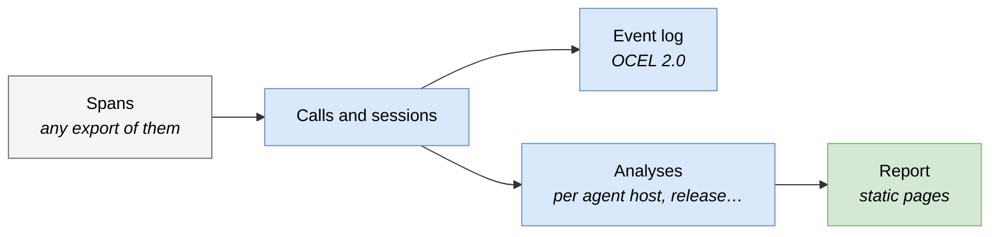
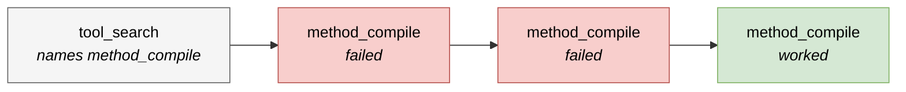

The [previous post](/posts/pharo-tools-observability/) showed what Pharo MCP and PLexus can record about each tool call an agent makes. One trace answers questions about one call: how long it took, and how it failed. The questions that make the tools better are about many calls. Which tools do agents struggle with? What do they do after a failure? Do they find the tool they need? Did the last release make any of it better?

[pharo-agent-analytics](https://github.com/Evref-BL/pharo-agent-analytics) answers them from the spans. It reads any export of them, rebuilds the calls and sessions, writes them as an object-centric event log, runs the analyses and draws a report you open in a browser. It is open source, under the Apache-2.0 licence, and works on your own spans as well as on spans many people share.

This post explains how it reads the agents' work, the research it builds on, and how it keeps its numbers honest.

## From spans to a report



A tool call leaves up to three spans: PLexus's span of the call it served, its span of the call it sent to the image, and the image's own. The analytics joins them into one **call**.

A call **failed** when the agent did not get what it asked for: its spans have an error status, or name an error type or a JSON-RPC error code. OpenTelemetry's conventions for MCP judge each span from its own side [@otel-genai-mcp]. A server that refuses a request, such as one whose arguments do not fit the tool's schema, did its job, so its span is not an error, while the client's span of the same call is. The analytics takes the agent's side, the client's, so a refused call is a failed call.

A **session** is the calls of one agent's work, and ends after 30 minutes without a call. Calls are ordered within their session by when they started.

## Why an object-centric event log

Process mining finds how a process really runs from an *event log*: a list of events, each with a time and the case it belongs to, such as one order in a shop. A tool call belongs to several things at once: its session, the tool it calls, the tools a search named, the places in its arguments that broke the schema, the release that served it. Give each call a single case, and the log distorts. With the tool as the case, a search that named three tools becomes three events: van der Aalst calls this convergence. With the session as the case, the calls of every tool interleave in one sequence, and calls about different things look like one loop: divergence [@vanderaalst2019]. An object-centric log keeps every relation instead.

OCEL 2.0, the standard for object-centric event logs, relates each event to any number of objects, and says how [@berti2024]. pharo-agent-analytics writes the calls as OCEL 2.0, in its SQLite and JSON forms, which process mining tools such as pm4py read. Its objects are the session, the tool, the agent host, the release, the places in a tool's input, and, when the spans have them, the agent host's turn, the agent and the model.

One object is ours: the **tool use**, a tool as one session used it. A tool's life across sessions would interleave the work of agents that never worked together. The pair of a session and a tool has a life of its own, which event knowledge graphs call a derived entity [@esser2021]:



Process mining is a recent way to look at agents. Fournier, Limonad and David apply process and causal discovery to agents' runs, to help developers see how their behaviour varies [@fournier2025]. Liu et al. draw 4,000 runs of SWE-agent and OpenHands as graphs: the runs that resolved their issue often went from locating the code to patching it to validating the patch, while the others were chaotic or backtracked [@liu2025]. Those read the agent's side of the work. pharo-agent-analytics reads the tools' side, from spans that any MCP server following the conventions can send.

## What it answers

Each analysis is computed for all calls, and again for each agent host, each release of MCP and PLexus, each Pharo version and each OS. Comparing two releases is choosing a facet.

- **Where agents struggle.** Which tools fail more than their use explains, how each tool fails, and where arguments break a tool's schema: which tool, which place in its input, which rule. The names of arguments agents reach for that a tool lacks.
- **How they get out of it.** What an agent does after a failure: the same call again, other arguments, another tool, a search, `evaluate`, or the end of the session. Then how many calls it takes until the tool works. SWE-agent's authors measured this for file edits: any edit succeeded in the end 90.5% of the time, but only 57.2% of the time after one failed edit [@yang2024]. A tool's errors cost the most in what follows them.
- **How they find their tools.** Whether a search leads to calling a tool it named, and what comes before a call to `evaluate`, the tool of last resort.
- **How the work flows.** A process map of which call follows which, whole sessions as variants, pairs of calls that follow each other more than chance would, which may want one tool or a richer answer, and the path from a compiled method to passing tests.
- **Where the time goes.** A tool's time against the agent's time after its answer, and calls the model asked for together in one answer.

## Markov models

A process map counts which call follows which: it is a first-order Markov chain, which assumes that the next call depends only on the last one. The analytics names its models as such and tests that assumption:

- **How far back the next call looks.** Chains that look back 0 to 3 calls, compared by likelihood ratio, AIC, BIC and how well they predict sessions they were not fitted on, as Singer et al. did for people browsing the web [@singer2014].
- **After a failure.** A chain over each tool and whether it worked or failed, in which the tool working and the session ending are absorbing. It gives the chance that a failed tool works before the session ends, and the calls it takes [@grinstead1997, ch. 11]. Set beside what was observed, it shows when the last call is not all that matters.
- **Phases.** A hidden Markov model over the tools called, fitted by Baum–Welch [@rabiner1989], with 1 to 6 phases. BIC and held-out sessions choose how many [@celeux2008]. The spans do not name the phases: the report shows each phase's tools and where it comes in a session.

## Keeping the numbers honest

A number here points at what to look at; it decides nothing. The spans say where agents struggle and how they get out of it, rarely why: the agents' transcripts say why. So each number comes with what keeps it from misleading.

- **Sessions, not calls.** The calls of one session are not independent: an agent retrying the same call forty times is one agent, not forty. Rates are given per session, with Wilson intervals, which hold on the small counts where the usual interval does not [@brown2001].
- **No ranking.** Tools are compared on a funnel plot: each tool's failure rate against how much it was used, with the limits chance alone would reach [@spiegelhalter2005]. A tool used twice that failed once is not the worst tool.
- **Competing outcomes.** A session can end before the failed tool works. Counting those sessions as merely unfinished would overstate recovery, so recovery is a cumulative incidence in which the session's end competes, estimated with Aalen and Johansen's method [@aalen1978].
- **The same mix.** A release that more agents of one host used is compared as it came, and again as if every release had seen the same mix of agent hosts.
- **A counter-number.** Completing the descriptions of MCP tools raised task success by a median of 5.85 points, and took 67% more steps [@hasan2026]. A success rate alone would have hidden the cost, so each number comes with the one that would show it being gamed. Mixing easy and hard work misleads too: longer runs seem to fail more, but the correlation reverses once task difficulty is controlled [@mehtiyev2026].
- **Too few data say so.** A view warns when its shares rest on fewer than 39 observations, the number at which a 95% Wilson interval around one half is 15 points wide on each side, or when the criteria that choose a model disagree. The report marks each view a warning concerns, and its sidebar can hide them.

## As much as the spans hold

The analytics uses what the spans hold, and says what they lack. Spans can be read as the tools send them, or after a filter kept less of them, as when people share their spans and a filter on their machine keeps only the week of each span and its place in its session. Everything above works on such spans. More spans give more:

| The spans hold | The analytics adds |
| --- | --- |
| Real times | When the tools are used, by weekday and hour |
| The agent host's trace context, passed with each call [@w3c-trace-context] | The host's turns: how many calls a turn takes, and the turns that met a failure and ended working |
| The agent host's own spans, by OpenTelemetry's GenAI conventions | The host's time for a call beyond the tool's, the model and the agent of each call, and the tokens per session |
| The tool's arguments, when content capture is on | A retry with the same arguments, told from one with other arguments; the classes and messages of the code sent to `evaluate`, never the code itself |

## Sharing a report

The report holds counts and rates, never a call. Read by others, it should not single anyone out either: `build --min-sessions k` hides what fewer than k sessions share, such as an agent host or release of its own, a sequence of calls, an argument name or an error message. Clio, Anthropic's platform for studying how its assistant is used, applies the same rule to its clusters, which are kept only above a minimum number of accounts and conversations [@tamkin2024]. The default, 1, shows everything, for whoever reads their own spans.

## Trying it

Keep the tools' spans on your machine with an [OpenTelemetry Collector](https://opentelemetry.io/docs/collector/) that writes them to a file, set up as [Getting the spans](https://github.com/Evref-BL/pharo-agent-analytics/blob/main/docs/getting-the-spans.md) shows, and point the tools at it as the [previous post](/posts/pharo-tools-observability/#turning-it-on) explains. Then, in a clone of the repository:

```sh
uv sync
uv run pharo-agent-analytics load spans/*.jsonl    # or fetch, from Elasticsearch
uv run pharo-agent-analytics build                 # the analyses, as the report's data
uv run pharo-agent-analytics ocel --out out/       # the event log, for process mining tools

cd site && npm ci && npm run dev                   # the report
```

The spans, and everything made from them, stay where they are read.

## Read more

- [The analyses](https://github.com/Evref-BL/pharo-agent-analytics/blob/main/docs/analyses.md): what each one answers, what keeps it honest, and when its calls are too few.
- [The event log](https://github.com/Evref-BL/pharo-agent-analytics/blob/main/docs/event-log.md): every object and relation.
- [Sources](https://github.com/Evref-BL/pharo-agent-analytics/blob/main/docs/sources.md): the research and tools the project builds on.
