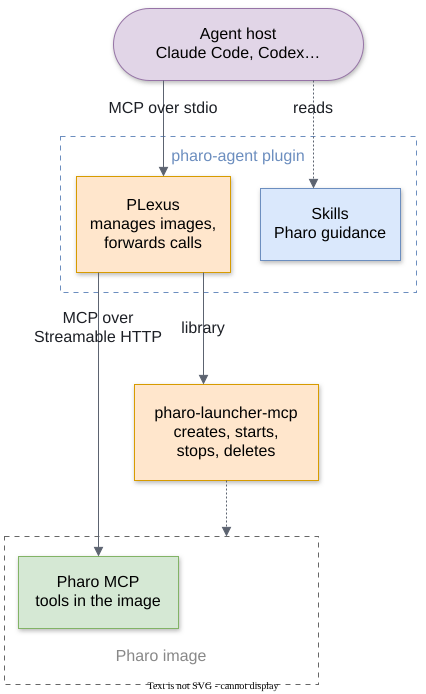

The first two posts of this series presented the pieces that let an AI agent work in Pharo. [Pharo MCP](/posts/pharo-mcp/) is a server inside a Pharo image, whose tools work through the Pharo IDE. [PLexus](/posts/plexus/) creates and runs as many of those images as the agent needs, and gives it all their tools through a single server.

You can set these pieces up yourself: install PLexus, declare it to your agent host, and install the Pharo guidance for agents into your project. The [pharo-agent plugin](https://github.com/Evref-BL/pharo-agent-plugin) does all of it in one install. This post explains what the plugin is, how it fits with the other pieces, and how to install it.

## What is an agent plugin?

Some agent hosts, such as Claude Code and Codex, can be extended with **plugins**. In Claude Code's [words](https://code.claude.com/docs/en/plugins), a plugin is a directory of skills, agents, hooks, MCP servers or other components. Plugins are installed from a **marketplace**: a repository that lists plugins and where to fetch each one. Once a marketplace is added, one command installs a plugin from it, and updating the marketplace brings the plugin's new releases.

The pharo-agent plugin carries two things:

- **One MCP server**: PLexus, from the plugin's own dependencies. The agent host starts it as a stdio server, and the agent gets its tools.
- **Skills**: the [guidance for agents](/posts/pharo-mcp/#guidance-for-agents) that Pharo MCP ships, and a skill to report problems with the tools.

The plugin runs no code of its own. Everything it does, PLexus and Pharo MCP do.

## From the agent to the image: every layer

Here is how the pieces fit together, from the agent down to the Pharo images. The plugin's box is what it installs; PLexus brings pharo-launcher-mcp with it. Everything below the agent host runs on the host's machine: PLexus as its subprocess, and Pharo MCP inside each image.



| Layer | What it does |
| --- | --- |
| **Agent host** | Calls the model, starts PLexus, and sends it the tool calls the model asks for. |
| **Skills** | Tell the agent how to work in Pharo, and which tool fits a task. |
| **PLexus** | Manages the images, and forwards each call for an image to that image. |
| **pharo-launcher-mcp** | Drives [Pharo Launcher](https://pharo-project.github.io/pharo-launcher/), which provides the image templates and the virtual machines. |
| **Pharo MCP** | Runs inside each image, and answers the calls through the Pharo IDE, such as its compiler, refactorings and tests. |

Each plugin release pins one release of PLexus and one of Pharo MCP, which were tested together. The images PLexus creates hold that release of Pharo MCP, and the plugin's skills are copied from it, so the guidance always matches the tools.

## A session, step by step

Say you ask the agent to fix a failing test in your Pharo project. Here is what it may do, with nothing set up beforehand:

1. It reads the Pharo guide, which tells it how to proceed.
2. It creates an image for the fix from a Pharo template, and starts it with its window open.
3. It loads your project into the image, from your Git checkout.
4. It runs the failing test, reads the code involved, and finds its senders.
5. It fixes the method. Pharo compiles it, and the agent runs the tests again.
6. You can review the fix in the image, and commit it with Iceberg.
7. The agent stops and deletes the image.

The agent chooses its steps on its own, each a tool call or a skill. None of them needs a port, a path to an image or a configuration change from you.

## Installing

You need [Node.js](https://nodejs.org/) and [Pharo Launcher](https://pharo-project.github.io/pharo-launcher/) on your machine. The plugin's [README](https://github.com/Evref-BL/pharo-agent-plugin#readme) gives the versions it needs and the current instructions for each agent host.

In Claude Code, add the marketplace and install the plugin:

```text
/plugin marketplace add Evref-BL/pharo-agent-plugin
/plugin install pharo-agent@evref-bl
```

The plugin is best enabled only in the projects where you work with Pharo, so that your other projects and conversations do not get its tools. For that, add these lines to the project's `.claude/settings.json`, which bring the marketplace with them:

```json
{
  "extraKnownMarketplaces": {
    "evref-bl": {
      "source": { "source": "git", "url": "https://github.com/Evref-BL/pharo-agent-plugin.git" }
    }
  },
  "enabledPlugins": { "pharo-agent@evref-bl": true }
}
```

The plugin itself writes nothing into your project: no configuration file, no copied guidance.

Codex installs the plugin from the same repository. OpenCode has no plugins of this kind, but it can run PLexus as an MCP server directly; the README shows how.

## Tell us what you need

The tools change as we learn how agents use them, and your experience helps. When a tool failed, misled the agent or needed a workaround, the agent offers once to run the plugin's feedback skill. The skill has it look back over the session's tool calls, draft issues for the tools' maintainers, check that they were not already reported, and file only the ones you name. You can also open issues directly in the repositories of [the plugin](https://github.com/Evref-BL/pharo-agent-plugin/issues), [PLexus](https://github.com/Evref-BL/PLexus/issues), [pharo-launcher-mcp](https://github.com/Evref-BL/pharo-launcher-mcp/issues) and [Pharo MCP](https://github.com/Evref-BL/MCP/issues).

## Learn more

- [The pharo-agent plugin on GitHub](https://github.com/Evref-BL/pharo-agent-plugin), with its README
- The first two posts of this series: [Pharo MCP](/posts/pharo-mcp/) and [PLexus](/posts/plexus/)
- [Claude Code's documentation on plugins](https://code.claude.com/docs/en/plugins)
