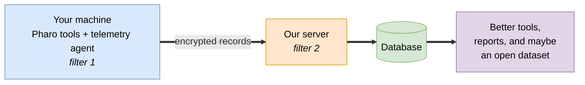
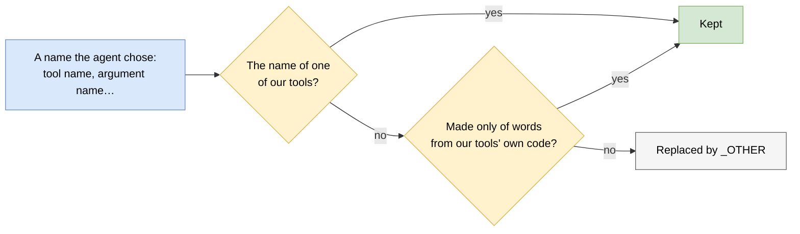
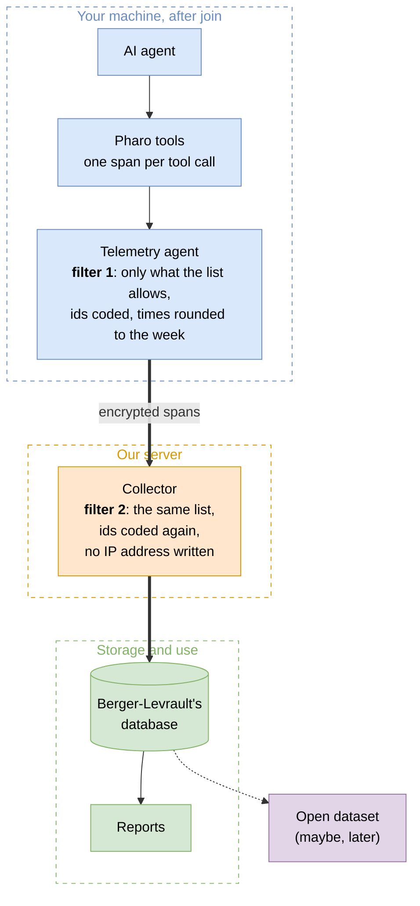
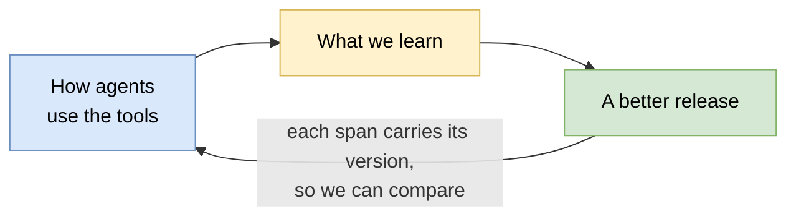
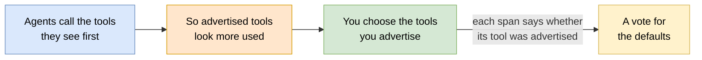

The [pharo-agent plugin](https://github.com/Evref-BL/pharo-agent-plugin), [PLexus](https://github.com/Evref-BL/PLexus) and [Pharo MCP](https://github.com/Evref-BL/MCP) give AI agents the tools they need to work in Pharo. Our goal is tools that fit the way agents really work with Pharo, so that your agents get things done with fewer steps, fewer mistakes and fewer tokens.

Until now, we shaped the tools only from our own sessions. That is not enough. In MCP 4.0, we removed the `test_coverage_run` tool, because our own agents had never called it. One day later, a user [asked why it was gone](https://github.com/Evref-BL/MCP/issues/399): they used it a lot, to audit their tests and raise their coverage. We brought it back in the next release. Our usage was not everyone's usage, and we had no way to know.

So we ask for your help. If you agree, the tools tell us how your own agents use them: which tools they call, which arguments they try, when a call fails and how. Never your code, your prompts or your data. With this, we can see what agents need, instead of guessing.

Joining is opt-in. Nothing is sent until you run `join`, the tools never ask you to, and you can leave at any time.

This post explains the study in simple terms. The official text for participants is the [participants page](https://github.com/Evref-BL/pharo-agent-study/blob/main/docs/participants.md). A [glossary](#glossary) at the end explains the technical words.

## In short

- **What is sent:** one small record per tool call: which tool, the names of the arguments (never their values), whether the call failed and why, rough sizes, how long it took, the versions in use, and the week.
- **What is never sent:** your code, your prompts, argument values, answers, file contents, error messages, file paths, and the names in your projects. Nothing that identifies you or your machine.
- **Checked twice:** on your machine, before anything leaves it, and again on our server.
- **Kept with no time limit**, so that it can become a dataset.
- **Public code and rules:** anyone can read what is kept and how. We wish to publish the findings too, and maybe the data itself.
- **Standard records:** OpenTelemetry spans, named as OpenTelemetry's [conventions](#built-on-opentelemetrys-conventions) say.
- **To take part:** see [Taking part](#taking-part). `preview` shows what would be sent, without sending anything.



## Why share, rather than tune your own tools

Agents that improve their own setup (their tools, prompts and code, often called their *harness*) are an active research topic. What they change has moved, over the years, from the prompt to the code around the model:

| What the agent changes | Examples |
| --- | --- |
| Its prompts and context | [DSPy](https://arxiv.org/abs/2310.03714) (2023), [GEPA](https://arxiv.org/abs/2507.19457) (2025), [ACE](https://arxiv.org/abs/2510.04618) (2025) |
| Its memory | [Reflexion](https://arxiv.org/abs/2303.11366) (2023), [Agent Workflow Memory](https://arxiv.org/abs/2409.07429) (2024) |
| Its skills and tools | [Voyager](https://arxiv.org/abs/2305.16291) (2023), [Agent Skills](https://www.anthropic.com/engineering/equipping-agents-for-the-real-world-with-agent-skills) (2025), [Live-SWE-agent](https://arxiv.org/abs/2511.13646) (2025) |
| Its own code | [ADAS](https://arxiv.org/abs/2408.08435) (2024), [Darwin Gödel Machine](https://arxiv.org/abs/2505.22954) (2025), [Meta-Harness](https://arxiv.org/abs/2603.28052) (2026) |

Most of this work falls into two groups.

The first group searches for a better agent offline, on a benchmark. [ADAS](https://arxiv.org/abs/2408.08435), the [Darwin Gödel Machine](https://arxiv.org/abs/2505.22954) and [Meta-Harness](https://arxiv.org/abs/2603.28052) rewrite the prompts, the tools or the whole agent, and score each new version on the benchmark. The researchers pay for this search, and it is expensive: one Darwin Gödel Machine run cost about 22,000 US dollars.

The second group improves while it works. [Live-SWE-agent](https://arxiv.org/abs/2511.13646) writes new tools for each task, and [ACE](https://arxiv.org/abs/2510.04618) grows a playbook of strategies. Here you pay, in time and in tokens, and what is learned stays with one task or one user: your tools become tuned to your own use case.

Learning from many users is newer. Some companies already study the tool calls of all their users to improve their own MCP server, like [PostHog](https://posthog.com/blog/how-ai-agents-behave) and [Amplitude](https://amplitude.com/blog/lessons-from-consolidating-our-mcp-server), and research has started to share skills between users, like [SkillClaw](https://arxiv.org/abs/2604.08377).

| | Offline search | On the job | Across users |
| --- | --- | --- | --- |
| **Learns from** | A benchmark | One task, one user | Many users |
| **Paid by** | The researchers | You, in time and tokens | The tools' maintainers |
| **Benefits** | The agent's users | You | Everyone who uses the tools |

We want to do this in the open, for one language community. Many people's agents use the same Pharo tools; together, their records show what works for Pharo development in general, not for one task or one person. You spend none of your time or credits on it, everyone gets the better tools, and we wish to share what we learn, so that it can help beyond Pharo too.

## What is sent

The tools use [OpenTelemetry](https://opentelemetry.io), a common standard for this kind of record, and its [conventions](#built-on-opentelemetrys-conventions). Each tool call makes one record, called a *span*. A call that goes through PLexus makes two: one from PLexus, and one from the Pharo image that ran it.

Only spans about tool calls are kept, and spans about PLexus creating, starting, stopping or deleting images. Anything else is dropped, for example a span that your own code makes in an image.

Of each span, only this is kept:

- **What it was:** the call (for example, a call to the tool `method_search`), and whether it ended well or with an error.
- **Where it ran:** which of our tools made the span, and its version; your operating system family (macOS, Linux or Windows); the Pharo version, as major and minor (like `14.0`); and the Node version, as major only. Each span also carries the word `field`, which says that it comes from a participant and not from our own tests.
- **What happened:**
  - the tool's name, and the names of the arguments the agent gave, never their values, even names the tool does not know;
  - if the call failed, how: for example, "an argument had the wrong type";
  - the size of the request and of the answer, rounded down to a power of two;
  - whether the answer was too long and was cut: our tools cut answers above a size limit, so that one answer does not fill the agent's memory;
  - some counts, like the number of results or of tests run, rounded;
  - the name and version of your [agent host](#glossary), for example Claude Code 2.1, when it is one we know.
- **Which calls belong together:** the ids that link the calls of one session, replaced by codes that cannot be traced back (see [Is it anonymous?](#is-it-anonymous)).
- **When:** only the week, how long the call took, and its place in the session. Never the time of day.

As a last safety net, if a kept name ever looks like a file path, an email address or an IP address (for example, if an agent used a path as a tool name by mistake), it is replaced whole.

The participants page lists every field, the tool it comes from, and the form it is kept in.

## An example

This span comes from a real session. It is kept in the study's repository as a test ([rules/observed.json](https://github.com/Evref-BL/pharo-agent-study/blob/main/rules/observed.json)). An agent called MCP's `method_search` tool with a `scope` argument of the wrong type, and MCP refused the call. This is all the telemetry agent sends of it:

```yaml
name: tools/call method_search
status: error
start: 2026-11-16T00:00:00Z      # the Monday of its week
resource:
  service.name: pharo-mcp        # the tool that made the span
  service.version: 4.2.0
  process.runtime.name: pharo
  process.runtime.version: "14.0"
  os.type: darwin                # macOS
attributes:
  gen_ai.tool.name: method_search
  session.id: <code>             # links the calls of one session
  pharo.mcp.argument.names: [query, scope]
  pharo.mcp.input.bytes: 32      # rounded down
  pharo.mcp.output.bytes: 1024   # rounded down
  pharo.mcp.output_budget.exceeded: false   # the answer was not cut
  error.type: tool_error
  pharo.mcp.error.kind: input_schema        # an argument was not valid
  pharo.mcp.error.schema.keywords: [type]   # it had the wrong type
  pharo.mcp.error.schema.paths: [/scope]    # this argument
  span.duration_ms: 0
```

What the telemetry agent changes on your machine, before anything is sent:

| What MCP records in your image | What the telemetry agent sends |
| --- | --- |
| Started on 2026-11-22 at 12:56:48.215 UTC | Only the week: Monday 2026-11-16 |
| The ids of the call and of the session | Codes that cannot be traced back |
| Pharo version `14.0.0+build.791` | `14.0` |
| The virtual machine's build, commit and date | Not sent |
| The OpenTelemetry library's name and version | Not sent |
| Request size: 37 bytes, answer size: 1063 bytes | 32 and 1024 |

The query the agent searched for, the scope it gave, the error's text and the answer are not in what is sent: the study's filter keeps none of them. What is left says that an agent expected `scope` to accept something it does not. This is exactly the kind of mistake the study is for.

## Built on OpenTelemetry's conventions

The spans are not a format of our own. Their fields are named as OpenTelemetry's *semantic conventions* say, including those that its [Generative AI Observability](https://github.com/open-telemetry/community/blob/5125996b5d159ff9aaa906f9a25226a821dc7bed/projects/gen-ai.md) project writes for AI programs and for MCP. [Observability for the Pharo agent tools](/posts/pharo-tools-observability/) explains these conventions, and how the tools follow them. For the study, this means:

- **Anyone can check what the data means.** Each field without our own prefix (`pharo.mcp.`, `plexus.`), like `gen_ai.tool.name` or `error.type` in the example, has a public definition. If we publish the data, its fields are names that researchers and tools already know.
- **The filter decides, not the tools.** The tools record what the conventions ask for, such as the request's id, the error's message and, if you turn them on, the arguments and the answer. The filter keeps only the fields on the study's list, and the status without its description, so none of it leaves your machine.
- **Fewer fields than the tools record.** A field that is the same in every span, like `gen_ai.operation.name`, says nothing, so the filters drop it.

## Names

Names are the hard case. Most of what is sent is a fixed field or a number. But some names are chosen by the agent: the name of a tool it tries to call, or the names of the arguments it gives. These names are what we most want to learn, because they show what agents expect. For example: an agent that writes `class_name` where the tool expects `className`, or that calls a tool that does not exist.

Your project's names could only appear here if an agent used one as a tool or argument name, which is rare. Still, they must not leave your machine. So a name is kept only in two cases:



The words come from the names in our tools' own code, split at `_`, `-` and capital letters, plus a short list of words that agents often guess. So `class_name` or `methodSource` pass, because our tools use those words. A name like `AcmeBilling` or a secret like `ghp_…` cannot pass: it becomes `_OTHER`, and never leaves your machine. A name made only of such common words says nothing about your project.

Each release of our tools adds new names. At most once a day, the telemetry agent asks our server for the newest list of names. It takes it only if the study's key signed it, and the list can only add names, never remove one. So the study keeps working with new versions of the tools, and nothing changes for older versions: their calls still count.

## What is never sent

- Argument values, answers, source code, prompts, file contents.
- Error messages and stack traces.
- File paths and image names.
- Names that are not made only of our tools' words (see [Names](#names)).
- Host names, user names, email addresses, IP addresses.
- Any id of you or your machine. There are no participant ids.
- Precise times: only the week, how long each call took, and its place in its session.

## Is it anonymous?

Yes, the data is anonymous. Nothing in a span says who sent it: there is no participant id and no machine id. The calls of one session share a session code, so we can study them together and in order. But nothing links one session to another session, to a machine or to a person. The codes are hashes: your machine makes them with a secret key that never leaves it, and our server hashes them again with its own key.

There are two limits, and we prefer to tell you:

- **A rare setup.** The versions in a span (of our tools, of Pharo, of Node, of your agent host, and your system family) are the same for everyone with the same setup. But if nobody else has your exact combination, your sessions could be told apart from the others. Someone who already knew your setup could then see how you used the tools, and nothing more. We keep versions short (major and minor) so that this is rarer.
- **Your IP address** reaches our server, as it reaches any server you connect to. The server needs it to answer, then forgets it: it is never written anywhere.

## How it travels



**On your machine.** `join` installs a small program, the telemetry agent, which runs in the background. The tools send their spans to it, inside your machine only. It keeps only what the participants page lists, replaces the ids with codes, and sends the result to our server over an encrypted connection. If the server cannot be reached, it waits and tries again later. Your tools never slow down or fail because of it.

**On our server.** The server applies the same filter again to everything that arrives. With two filters, one bug alone cannot leak anything. Both filters are made from the same list as the participants page, and tests check that they keep exactly what the page says.

**Into the database.** From the server, the spans move into Berger-Levrault's database.

## How long, and who can see it

The database keeps the spans with no time limit, so that they can become a dataset that others can study too.

The study's code, its rules and the participants page are public. We wish to publish what it finds too, and maybe the spans themselves, as an open dataset, with nothing more in them than the participants page lists. This is why the filters keep only what could be shown to anyone. A published copy cannot be withdrawn.

## How it will be used

A spoken language changes with use: a phrase that people say often becomes a word, a form nobody uses disappears, a common mistake becomes the norm. We want the tools to change the same way, from what agents actually do with them. Some examples of what the data can show, and what it could change:

| What the data shows | What it could change in the tools |
| --- | --- |
| Tools that agents often call one after the other, like `class_get` then `method_get` | One tool that does both, or a richer answer |
| Tools that nobody calls | Removing them, or a better description if the need is real |
| `evaluate` (run any code) used where no tool fits | A new tool |
| Argument names that agents give but a tool does not accept | Accepting those names too |
| Calls refused because of a wrong argument, then tried again differently | A clearer description or error message |
| Answers cut because they were too long | Answers in pages, or a summary first |
| Tool names that do not exist | A new name for an existing tool, or a new tool |



### Which tools the agent sees first

Pharo MCP has dozens of tools. If an agent saw all of them at the start, their descriptions would fill its memory before it did any work. So the server shows the agent only some of them up front: these are the **advertised** tools. The others are **discoverable**: the agent does not see them at first, but finds them when it needs one, by searching with the `tool_search` tool, and then calls it with `tool_call`.

This split creates a bias. An agent calls the tools it sees more often than the ones it has to look for. So advertised tools look more used, partly because they are advertised. If we chose the list only by counting calls, it would never change.

But the list is not fixed. Since MCP 4.4, you choose which tools every image you run advertises, in one file of your configuration, `~/.config/pharo-mcp/tools.json` ([how](https://github.com/Evref-BL/MCP/blob/main/docs/user/building-on-mcp.md#shaping-the-servers-surface)):

```json
{
  "advertise": ["test_coverage_run"],
  "unadvertise": ["critique_run"]
}
```

If you advertise the tools you use most, your choice becomes a vote. Each span says whether its tool was advertised, and whether the call went straight to the tool or through `tool_call`, so we can see which tools people bring to the front, and how their agents use them after that. Together, these votes can decide which tools are advertised by default.



The data has limits. It shows what agents do, and how this changes from one release to the next. It does not show whether you got what you wanted, why the agent made a call, or what happened outside our tools. So it tells us where to look. It does not decide for us.

## Who answers for it

- **Berger-Levrault** is responsible for the data (the GDPR's "controller"). Write to Gabriel Darbord at gabriel.darbord@berger-levrault.com with any question, or ask in public on [the study's issues](https://github.com/Evref-BL/pharo-agent-study/issues).
- **Your consent** is the basis. Running `join` after reading the participants page gives it, and `leave` takes it back, at any time, with no effect on what the tools do for you.
- **Your rights.** After `leave`, nothing more is sent. What was sent before stays in the database: since it is anonymous, there is no way to find which records are yours, so they cannot be shown, corrected or deleted for you (GDPR Art. 11). You can complain to your data protection authority: in France, the [CNIL](https://www.cnil.fr).

## Taking part

You need:

- Node 22.15 or later, to run the study's commands;
- and one of:
  - the pharo-agent plugin 0.23 or later;
  - PLexus 0.21 or later, if you use it without the plugin;
  - MCP 4.3 or later, if you use Pharo MCP alone in your own image (see [below](#with-mcp-alone)).

Older versions are not supported: their spans may never reach the study.

```sh
npx @evref-bl/pharo-agent-study preview   # see what would be sent, without sending anything
npx @evref-bl/pharo-agent-study join      # take part
npx @evref-bl/pharo-agent-study status    # see what was received and sent
npx @evref-bl/pharo-agent-study leave     # stop, and remove everything join installed
```

- **`preview`** shows what would be sent, live, and sends nothing. Restart your agent host so that the tools pick it up.
- **`join`** installs the telemetry agent, which starts when you log in, and points the tools' settings at it. Restart your agent host after joining.
- **`status`** says whether the telemetry agent is running, and what it received and sent.
- **`leave`** stops the telemetry agent, removes it and its key, and puts your settings back as they were. Sending stops at once.

The participants page gives the details: which files `join` writes, and what to do on a machine that cannot run a background service.

### With MCP alone

If you use Pharo MCP in your own image, without PLexus, join as above, then in the image:

1. Load MCP's `Telemetry` group, from the same repository you loaded MCP from: the same `baseline: 'MCP'; repository: ...` as before, with `load: #( 'Telemetry' )`.
2. Evaluate `MCP useOpenTelemetryObservabilityByDefault`, then save the image. If you do not save it, the setting is lost at the next start.

An image inside a container cannot reach the telemetry agent: the container is not your machine.

## Glossary

- **AI agent:** a language model that works on a task by calling tools, like Claude or GPT.
- **Agent host:** the program that runs the AI agent and gives it tools, like Claude Code, Cursor or Visual Studio Code.
- **MCP (Model Context Protocol):** the standard way agent hosts give tools to agents. Pharo MCP is our MCP server: it runs inside a Pharo image.
- **Advertised tool:** a tool the server shows the agent from the start.
- **Discoverable tool:** a tool the agent does not see at first, but can find with `tool_search` and call with `tool_call`.
- **Tool call:** the agent asks for one action, like "find the methods named `printOn:`", and gets an answer.
- **OpenTelemetry:** an open standard for recording what programs do, used by many tools.
- **Semantic conventions:** OpenTelemetry's shared names for what a span records, so that a field means the same thing whatever program wrote it.
- **Span:** one OpenTelemetry record of one operation: what it was, how long it took, how it ended.
- **Session:** the calls an agent makes in one stretch of work. A new session starts after 30 minutes without a call.
- **Telemetry agent:** the small program that `join` installs on your machine. It filters the spans and sends them to our server. It is not an AI agent.
- **Collector:** the program on our server that receives the spans, filters them again, and stores them.
- **Hash (code):** a short code computed from a value. The same value gives the same code, but you cannot go back from the code to the value.
- **Answer size limit:** our tools cut an answer that is too long, so that it does not fill the agent's memory (its context).

## Read more

- [The participants page](https://github.com/Evref-BL/pharo-agent-study/blob/main/docs/participants.md): every field, and the full notice.
- [The study's repository](https://github.com/Evref-BL/pharo-agent-study): what is kept, exactly as the filters read it, and a test for each rule.
- [Observability for the Pharo agent tools](/posts/pharo-tools-observability/): what the tools record, and how they follow OpenTelemetry's conventions.
- [pharo-agent-telemetry](https://github.com/Evref-BL/pharo-agent-telemetry): the code that runs the study, which anyone can reuse for a study of their own.
