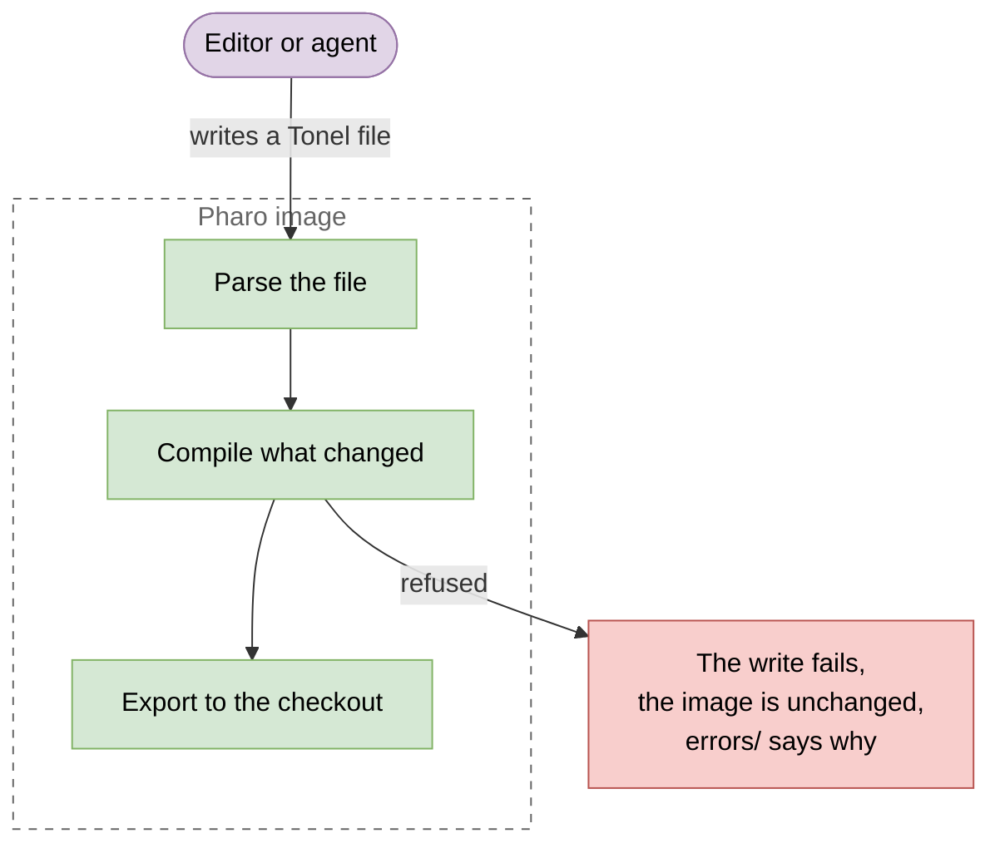
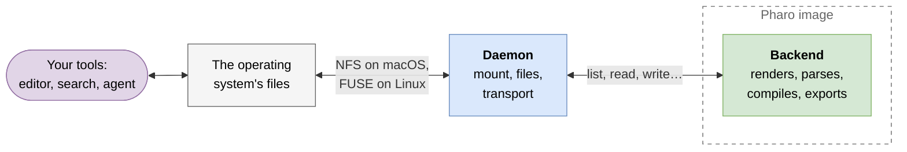

Coding agents are at home with files. They search a codebase with `grep` or `rg`, read a file, change it with an edit or a patch, and check the result with `git diff`. Most code is written this way, so this is what they do best.

Pharo code is not in files. It lives in a running image, and the files on disk are an export of it: editing them changes nothing in the image until they are loaded again. [Pharo MCP](/posts/pharo-mcp/) answers this with tools that work inside the image. [pharo-image-fs](https://github.com/Evref-BL/pharo-image-fs), PIFS for short, takes the other way: it makes the image look like a folder of files, so that the agent's own file tools work on it. Pharo still has the last word: the image parses and compiles every file written, and a write it refuses fails.

This post explains what the folder holds, what a write does, how it works, and how to try it.

## The image as a folder

PIFS *mounts* the image: it adds a folder to your file system, as a network share does, whose content comes from the image. The folder holds four others:

```text
<mount>/
  tonel/
    MyProject/
      MyClass.class.st
      String.extension.st
  critiques/
  errors/
  repositories/
```

| Folder | What it holds | Writable |
| --- | --- | --- |
| `tonel/` | One folder per package of the image, with a file per class, and one per class that the package extends | Yes: this is where code is edited |
| `critiques/` | The critiques of the code written through the mount | No |
| `errors/` | Why the last writes failed | No |
| `repositories/` | A link to the checkout of each Iceberg repository loaded in the image | Through the link, like any folder on disk |

The files under `tonel/` are in [Tonel](https://github.com/pharo-vcs/tonel), the format Iceberg writes to a repository, so they look like the files of a checkout. But they come from the image, not from the disk. Every package of the image is there, Pharo's own included, whether it belongs to a repository or not. An agent searches the whole system with one `rg`, the way it would search any codebase.

Nothing is copied when the mount starts. A file is made when a program reads it, from the image as it is at that moment, so a change made in the image, in the IDE or through Pharo MCP, shows in the files at a later read.

## What a write does

When a program writes a file under `tonel/`, the whole file goes to the image:



1. The image **parses** the file, and compares it with the class it holds. Only the definitions and methods that changed are compiled; the others are left as they are.
2. Pharo's compiler **compiles** them, and the critiques run on them.
3. The package is **exported** to the checkout of its repository, so `git diff` there shows the change, ready to commit.

A write is all or nothing. If the file does not parse or a method does not compile, nothing is applied: the image keeps the class as it was, and the write fails, as a write to a full disk would. `errors/latest.txt` says what went wrong and where. A program that does not check whether its write succeeded misses the error, but the image still refuses the file, and `errors/` still says why.

The critiques of the methods written land under `critiques/`, so the agent reads them as files too.

Other operations on the files are Pharo operations:

| On the mount | In the image |
| --- | --- |
| Write a `.class.st` file | Change the class, or create it if the file is new |
| Write a `.extension.st` file | Change the methods the package adds to that class |
| Delete a `.class.st` file | Remove the class |
| Rename a `.class.st` file | Rename the class, and update the code that refers to it |
| Move a `.class.st` file to another package's folder | Move the class to that package |
| Remove an empty package folder | Remove the package |

By default, a write must go to a package that belongs to an Iceberg repository with a checkout, so that every change reaches the files that Git sees. In a scratch image, where nothing needs to be committed, that check can be turned off: any package can then be written, and a new folder under `tonel/` creates a package.

Editors save files in many ways. Some write a temporary file and rename it over the original; PIFS keeps such a file to itself until it is renamed onto a Tonel file, which the image then receives as one write.

## How it works

PIFS has two parts: a package in the image, the **backend**, and a small program outside it, the **daemon**.



The **daemon** does everything about files. It mounts the folder and answers the operating system. On macOS, it serves the folder over [NFS](https://en.wikipedia.org/wiki/Network_File_System) version 3 [@rfc1813], the protocol of network shares, and the system mounts it with its own client: there is nothing to install. On Linux, it goes through [FUSE](https://docs.kernel.org/filesystems/fuse/fuse.html), the kernel's way to let an ordinary program serve a file system. It holds a file while a program writes it, and passes each operation to the image in a short request: list, stat, read, write, delete, rename, mkdir and rmdir. It knows nothing about Pharo code.

The **backend** does everything about Pharo. It renders classes as Tonel files, parses and compiles what is written, keeps the critiques, and exports to the checkouts. That way, the code in the files is always what Pharo makes of it, and the image stays the one source of truth.

The two are released together, at the same version. The backend downloads the matching daemon the first time it mounts, so loading the backend is all there is to install. PIFS runs on macOS and Linux; Windows is not supported yet.

## Files and tools together

PIFS does not replace Pharo MCP. Some work is better done as an operation than as text:

- **With files:** searching code by its text, reading whole classes, rewriting many methods at once, reviewing what changed with `git diff`.
- **With tools:** a refactoring that renames a method everywhere it is sent, running the tests, the critiques of a whole package, working with Iceberg.

An agent with both uses each where it fits. The repository holds a short [agent guide](https://github.com/Evref-BL/pharo-image-fs/blob/main/templates/AGENTS.md) that says this to an agent, for a project whose agents edit through the mount.

The two also meet in the image. In an image that runs Pharo MCP, PIFS's `Tools` group adds three tools: `pifs_start` mounts the image, `pifs_list` lists its mounts, and `pifs_stop` unmounts one. They are [discoverable](/posts/pharo-mcp/#advertised-and-discoverable-tools), not advertised, so they take no room in the agent's context until it searches for them. With them, an agent mounts its own image when it needs files.

## Trying it

Load PIFS in a Pharo image, and start a projection:

```st
Metacello new
	baseline: 'PharoImageFS';
	repository: 'github://Evref-BL/pharo-image-fs:main/src';
	load.

projection := PIFSServer start.
projection mountPath.
```

It mounts in the system's temporary folder, under the name of the image, and `mountPath` says where. On Linux, it needs `fusermount3`, from the `fuse3` package; on macOS, nothing. Then, from a terminal:

```sh
rg "printOn:" <mount>/tonel
```

`projection stop` unmounts it. Where it mounts, which packages it shows, whether it formats the methods it compiles, and which writes it accepts are all set when it starts: [Starting a projection](https://github.com/Evref-BL/pharo-image-fs/blob/main/docs/starting.md) explains how.

## Learn more

- [pharo-image-fs on GitHub](https://github.com/Evref-BL/pharo-image-fs), with its README and releases
- [Starting a projection](https://github.com/Evref-BL/pharo-image-fs/blob/main/docs/starting.md): the configuration, and the MCP tools
- [Using the mount](https://github.com/Evref-BL/pharo-image-fs/blob/main/docs/using-the-mount.md): what each folder holds, and every operation a write can make
- [pharo-image-fs-daemon](https://github.com/Evref-BL/pharo-image-fs-daemon): the daemon
- [Pharo MCP](/posts/pharo-mcp/), the tools that work inside the image
