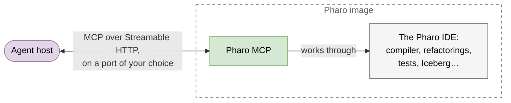
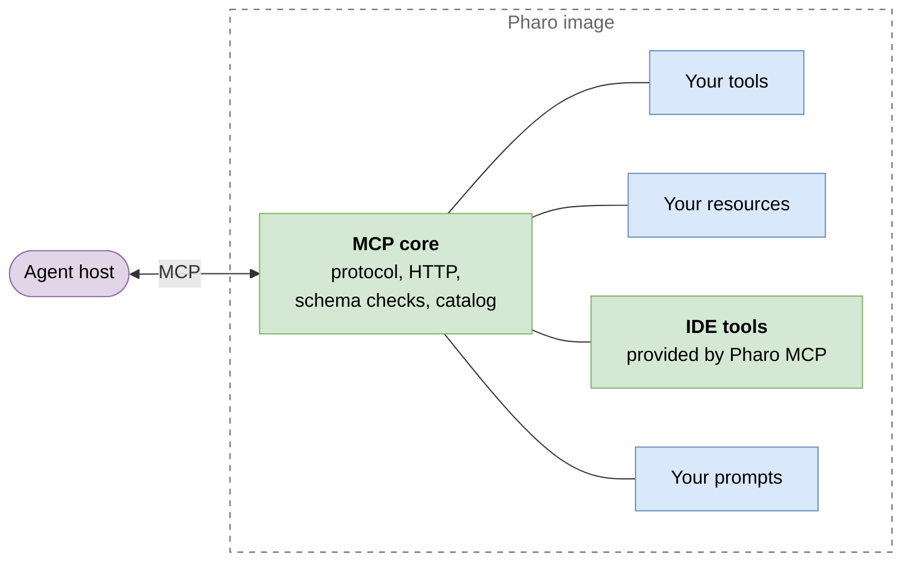
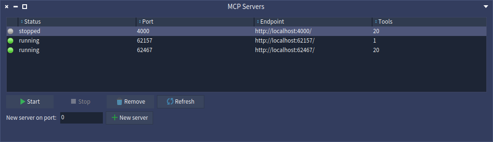
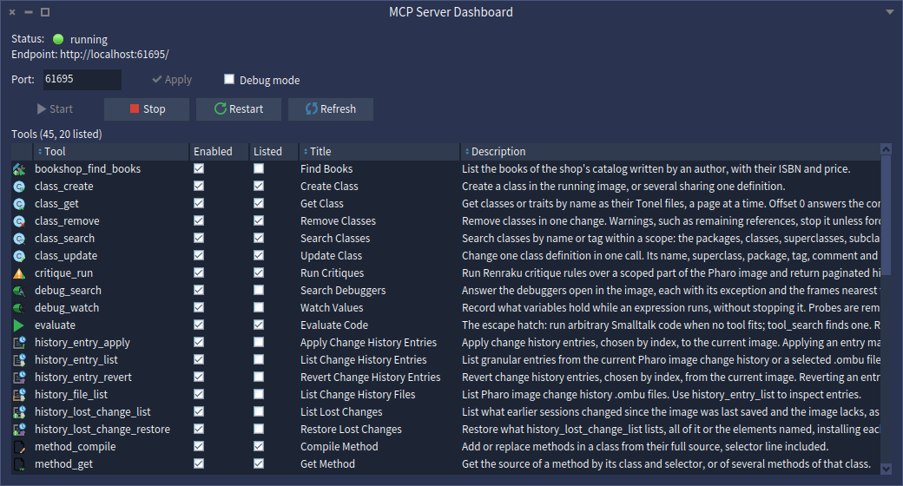
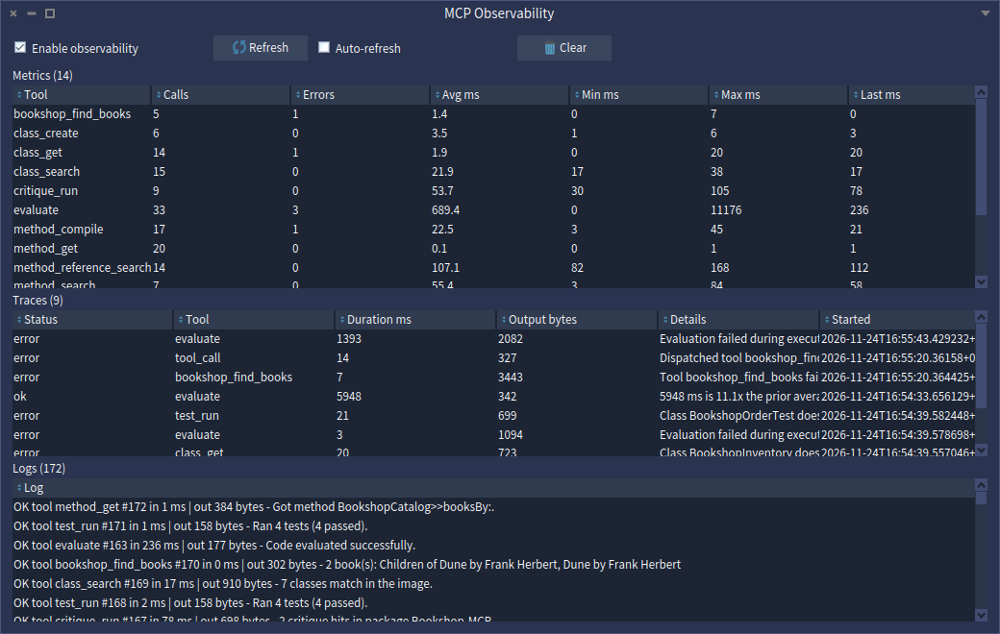
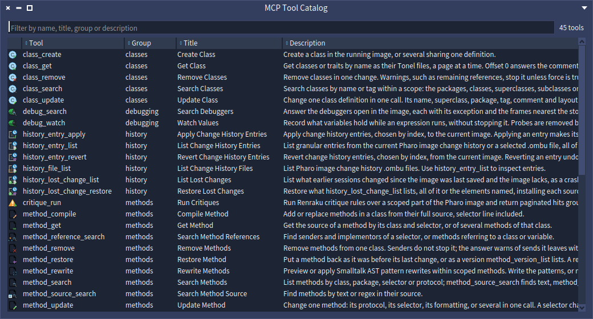

AI agents now write code. They read files, run commands, run the tests, and change the code until the tests pass. In most languages, the code is in text files, and the compiler and the tests run from a terminal.

Pharo is different. The code lives in a running image, together with its objects, its compiler, its refactorings and its test runner. The files on disk are an export of the image's code: editing them changes nothing in the image until they are loaded again. [Pharo MCP](https://github.com/Evref-BL/MCP) lets the agent work in the image itself, with the same tools a Pharo developer uses.

This post explains the idea: what the protocol is, what Pharo MCP adds to an image, the tools we provide, and how you can plug in your own. It is the first of three posts. The second presents [PLexus](/posts/plexus/), which gives an agent as many images as it needs, and the third [the pharo-agent plugin](/posts/pharo-agent-plugin/), which puts everything in one install.

## Agents and tools

An agent is a large language model (LLM) that uses tools in a loop. The model reads and reasons; its **tools** let it act, such as running a command, reading a file or calling a service. The application that calls the model and runs its tools is the **agent host**: Claude Code, Codex and OpenCode are agent hosts.

Coding agents work mostly through a terminal and tools that read and edit files. With them, an agent creates a branch, edits the code, runs the tests, commits and opens a merge request. In Pharo, those tools stay outside the image: a command in a terminal does not reach the image that is running, and an edited file does not change it. The agent needs tools that work inside the image.

## The Model Context Protocol

The [Model Context Protocol](https://modelcontextprotocol.io/) (MCP) is an open standard for connecting AI applications to tools and data. Its specification is published in dated revisions; this post follows revision 2026-07-28, the latest when it was written. The [architecture](https://modelcontextprotocol.io/specification/2026-07-28/architecture) it describes has three roles:

- An **MCP server** is a program that offers tools and other context.
- The **host** is the application the agent runs in. In this series, it is the agent host.
- A **client** is the part of the host that keeps the connection to one server. A host has one client per server it uses.

A host can use any server that supports a revision of the protocol it also supports, whoever wrote either one.

Client and server exchange [JSON-RPC](https://www.jsonrpc.org/) messages over a **transport**. The revision [defines two](https://modelcontextprotocol.io/specification/2026-07-28/basic/transports), and allows custom ones:

| | stdio | Streamable HTTP |
| --- | --- | --- |
| The server process | The client launches it as a subprocess. | It runs on its own, and can serve several clients. |
| How messages travel | Through the server's standard input and output, one JSON-RPC message per line | Each message from the client is an HTTP POST to the server's single endpoint, which answers with JSON or with a stream of Server-Sent Events |
| Where the server runs | On the client's machine | On the client's machine or elsewhere on the network |

A tool has a name, a description, and an **input schema**: a [JSON Schema](https://json-schema.org/) of the arguments it takes. The model reads the description and decides when to call the tool. Here is the example from the [specification's page on tools](https://modelcontextprotocol.io/specification/2026-07-28/server/tools), without its icon:

```json
{
  "name": "get_weather",
  "title": "Weather Information Provider",
  "description": "Get current weather information for a location",
  "inputSchema": {
    "type": "object",
    "properties": {
      "location": {
        "type": "string",
        "description": "City name or zip code"
      }
    },
    "required": ["location"]
  }
}
```

The model never runs the tool itself. It asks for a **tool call**, with arguments that fit the schema. The host sends the call to the server through its client, as a `tools/call` request, and gives the **tool result** back to the model. The description and the schema are all the model knows about the tool, so a good description matters as much as good code.

Tools are not the only thing a server can offer. In this revision, a server can offer [three features](https://modelcontextprotocol.io/specification/2026-07-28/server), which differ by who controls them:

| Feature | What it is | Controlled by |
| --- | --- | --- |
| [Tool](https://modelcontextprotocol.io/specification/2026-07-28/server/tools) | An action the server performs, with arguments | The model, which decides when to call it |
| [Resource](https://modelcontextprotocol.io/specification/2026-07-28/server/resources) | Data the server exposes under a URI, such as a document | The host application, which decides what to give the model as context |
| [Prompt](https://modelcontextprotocol.io/specification/2026-07-28/server/prompts) | A message template, which can take arguments | The user, who picks one, for example as a slash command |

## A server inside the image

Pharo MCP is an MCP server written in Pharo, and it runs inside your image. You load it like any Pharo project, start it on a port, and tell your agent host where to find it. From then on, the agent's tool calls run in the live image.



Because the server is inside the image, its tools work through Pharo itself rather than through text. When the agent adds a method, Pharo compiles it, and a compilation error comes back in the tool result. A rename is a refactoring, which also updates the code that refers to what was renamed. Tests run with SUnit, [critiques](#critiques-feedback-on-every-change) come from Renraku, and repositories are handled by Iceberg. The agent uses the same machinery you use in the IDE, so the code it changes stays consistent.

Pharo MCP is built on [Zinc](https://github.com/svenvc/zinc) for HTTP, on [JRPC](https://github.com/Evref-BL/JRPC) for JSON-RPC (our fork of [Julien Delplanque's library](https://github.com/juliendelplanque/JRPC)), and on Pharo's own IDE for the tools.

To try it, load it with Metacello and start a server:

```st
Metacello new
	baseline: 'MCP';
	repository: 'github://Evref-BL/MCP:vX.Y.Z/src';
	onConflictUseIncoming;
	load.

MCP startOnPort: 4000.
```

Name a [release](https://github.com/Evref-BL/MCP/releases) in place of `vX.Y.Z`. The protocol sets no default port, and Pharo MCP listens on the one you give it; 4000 is the port that the README's [agent templates](https://github.com/Evref-BL/MCP#agent-templates) expect. The server then answers at `http://127.0.0.1:4000`. It listens on `127.0.0.1` only, so nothing outside your machine reaches it, as the specification [advises](https://modelcontextprotocol.io/specification/2026-07-28/basic/transports/streamable-http) for a server that runs locally. Each agent host has its own way of declaring a server; the [getting started guide](https://github.com/Evref-BL/MCP/blob/main/docs/user/getting-started.md) explains how to connect one, and the [README](https://github.com/Evref-BL/MCP#readme) says which Pharo versions and which protocol revisions are supported.

## A generic MCP server

At its core, Pharo MCP is a generic MCP server. It speaks the protocol, validates the arguments of every tool call against the tool's input schema before running it, and keeps a catalog of what it offers. This core knows nothing about Pharo code. Everything the server offers is a class that you can write yourself: tools, resources and prompts alike.



A tool is a subclass of `MCPTool` whose class answers a `toolName`. It gives its description and its input schema, and turns a call into a tool result. This one, from the guide [Building on MCP](https://github.com/Evref-BL/MCP/blob/main/docs/user/building-on-mcp.md), lists the widgets of an imaginary project:

```st
MyProjectToolListWidgets class >> toolName

	^ 'widget_list'

MyProjectToolListWidgets >> description

	^ 'List the widgets this image holds, optionally those whose name starts with a prefix. Use widget_get to read one.'

MyProjectToolListWidgets >> buildInputSchema

	^ MCPStructureInputSchema
		  properties: { ((self
				    schemaPropertyNamed: 'prefix'
				    type: 'string'
				    description: 'Only answer widgets whose name starts with this. Defaults to all of them.')
				   default: '';
				   yourself) }
		  required: #(  )

MyProjectToolListWidgets >> executeWithRequest: request

	| prefix names |
	prefix := request argumentOrDefaultNamed: 'prefix'.
	names := (MyProject widgetNames select: [ :each | each beginsWith: prefix ]) asArray sorted.
	^ self
		  successResultText: names size asString , ' widget(s): ' , (', ' join: names) , '.'
		  data: { (#widgets -> names) } asDictionary
```

There is nothing to register by hand. A class that names itself is registered once its package is loaded: every server in the image then has `widget_list` in its catalog, next to the IDE tools, and an agent can find it and call it. It is not advertised unless you ask for it, as explained [below](#advertised-and-discoverable-tools). Your project keeps its tools in a package of its own, and leaves that package out of the images that do not serve MCP.

Resources and prompts work the same way. A subclass of `MCPResource` whose class answers a `resourceUri` is a resource that the host can read, such as your project's documentation or a report built from the image. A subclass of `MCPPrompt` whose class answers a `promptName` is a prompt that the user can pick, such as "review this class". Pharo MCP supports all three features, even though it provides no resources or prompts of its own for now.

You can also leave our tools out entirely. The baseline's `Core` group loads the server alone, without the IDE tools. A project can then build an MCP server for its own domain in Pharo, and serve only its own tools. The guide [Building on MCP](https://github.com/Evref-BL/MCP/blob/main/docs/user/building-on-mcp.md) walks through a tool, a resource and a prompt, and shows how a project's baseline depends on Pharo MCP.

## The IDE tools we provide

Out of the box, Pharo MCP gives an agent what a Pharo developer uses every day:

- **Exploring code:** search packages, classes and methods, find senders and references, and read their source.
- **Changing code:** create and change classes, compile methods, and run refactorings.
- **Checking code:** run tests, run critiques, and evaluate code in the image.
- **Version control:** work with the image's Iceberg repositories, and move code between the image and its files.
- **History and debugging:** read the image's change history and recover what a crash lost, look at the debuggers open in the image, and watch the values code goes through while it runs.
- **The user interface:** see what the image shows on screen.

The exact list changes from one release to the next. We add, rename and remove tools as we learn how agents use them. The agent never needs to know the list in advance, because the server always says what it has, as the next section explains, and each tool carries its own description and input schema.

## Advertised and discoverable tools

Every tool description the host gives the model takes room in its context, and costs tokens before any work starts. With many tools, listing them all would fill the context with descriptions the model may never need. So Pharo MCP shows its tools in two ways:

| | How the model learns of them | Which tools |
| --- | --- | --- |
| **Advertised** | In the server's answer to `tools/list`, which the host reads when it connects | The tools most tasks need |
| **Discoverable** | By searching the server's catalog, when needed | Every other tool, including the ones from your own projects |

A few **catalog tools**, which are advertised, connect the two: they search the catalog, show one tool's description and input schema, and call any tool of the catalog by its name. An agent that needs a specialised tool searches for it, reads its description, and calls it. Until then, the descriptions of the discoverable tools take no room in the context.

Which tools are advertised is a default, not a rule. You can change it, for every image you run, in a small configuration file: [Shaping the server's surface](https://github.com/Evref-BL/MCP/blob/main/docs/user/building-on-mcp.md#shaping-the-servers-surface) explains how.

## Guidance for agents

Tools alone are not enough. An agent also needs to know how to work in Pharo: that the image and the files on disk are two different things, that Git sees a change made in the image only once it is written to the files, or which tool fits a task. Pharo MCP therefore ships guidance for agents along with its tools: a guide, references, and **skills**. A skill is a set of instructions for one kind of task, such as loading a project or reproducing a CI failure, which the agent loads only when its task matches the skill's description.

The [README](https://github.com/Evref-BL/MCP#agent-templates) explains how to install this guidance into a project for a given agent host. The [pharo-agent plugin](/posts/pharo-agent-plugin/) carries the same guidance, so its users have nothing to install.

## Critiques: feedback on every change

The guidance is read once, when a task starts or a skill applies. As the agent's context fills up, the agent can lose track of it. Critiques work the other way: they come back each time the agent changes code.

A **critique** is what Pharo's static analysis, Renraku, finds in a piece of code: what other languages call a linter warning. Each critique comes from a **rule**, a class that looks for one problem, such as a message sent that nothing implements, or a `postCopy` that does not call `super postCopy`. Pharo comes with many rules, grouped by kind, each with a severity: information, warning or error.

When the agent compiles a method, the tool result lists the critiques of the method as compiled, so the agent can fix what they point out before going further. To keep that result short, it holds the critiques that matter most: those of rules whose severity is error, and a selection of warnings. That selection includes rules that Pharo MCP adds for agents, which point to a more direct or cheaper way of writing the same thing: `count:` rather than selecting elements only to ask how many there are, or a stream rather than a chain of concatenations, each of which copies everything to its left. Those rules speak only to agents: the IDE never shows them to you.

A tool also runs the rules over a part of the image, such as a package or a class hierarchy, with every severity. The agent can use it to check its work before handing it over, or to find what to clean up.

The rules are yours to shape, and Pharo MCP follows what you decide, with nothing to configure on its side:

- **Turning a rule on or off.** Pharo's settings list every rule under *QualityAssistant*, where you can turn it off, and banning a rule for the whole image from one of its critiques turns it off too. A rule that is off is off for the agent as well.
- **False positives.** A package's manifest can mark a critique as a false positive for a class or a method. The agent does not see it there either.
- **Rules of your own.** A rule is a subclass of one of Renraku's rule classes. As soon as it is in the image, it runs for the agent, with no registration. When a rule of your own has the severity error, what it finds comes back with every compile; with a lower severity, it comes up when the agent runs the rules.

For example, a bookshop counts its prices in whole cents, because a Float cannot hold most decimal amounts exactly. This rule, a subclass of Renraku's `ReNodeBasedRule`, flags any Float written in the bookshop's code:

```st
BookshopFloatMoneyRule class >> ruleName

	^ 'Money is counted in whole cents, never in a Float'

BookshopFloatMoneyRule class >> rationale

	^ 'A Float cannot hold most decimal amounts exactly, so sums drift by fractions of a cent. Compute with integers or fractions, and round to whole cents once.'

BookshopFloatMoneyRule class >> severity

	^ #error

BookshopFloatMoneyRule >> basicCheck: aNode

	^ aNode isLiteralNode and: [
		  aNode value isFloat and: [ aNode methodNode methodClass package name beginsWith: 'Bookshop' ] ]
```

Once the rule is loaded, an agent that compiles this method:

```st
BookshopBook >> salePrice
	"Ten percent off during the sale."

	^ price * 0.9
```

gets this back in the tool result:

```text
Created BookshopBook>>salePrice.
critiques (line numbers count the method as stored; method_get shows it):
  line 4: Money is counted in whole cents, never in a Float
    0.9
```

It can then write `^ (price * 9 / 10) rounded`, which compiles with no critique.

This is how a team can teach an agent its conventions in a way that lasts: a rule written once checks the code of every agent and every developer working in the image.

## Watching what the server does

Pharo MCP also has a user interface in the image. The screenshots below come from an image holding a small example project, a bookshop, after an agent worked on it.

The world menu lists the image's servers under *Library → MCP Servers*. From there a server can be started, stopped or opened, and a new one created on a port. This image has three servers: a running one with every tool, a running one that serves only the bookshop's own tool, and a stopped one, selected here, which can be started again or removed.



An inspected server shows two tabs. The **dashboard** shows the server's status and endpoint, and every tool it could run, with whether it has the tool (*Enabled*) and whether `tools/list` shows it (*Listed*). The bookshop's tool is enabled but not listed: an agent finds it by searching the catalog.



The **observability** tab shows what the server recorded about itself: timing metrics per tool, traces of the calls that failed, took unusually long or answered too much, and recent log lines.



The tool catalog, under *Library → MCP Tool Catalog*, lists every tool the image holds, with its group, title and description, and filters them by any of these.



When its image loads the `Telemetry` group, a server can also record each tool call as a span of [OpenTelemetry](https://opentelemetry.io/), an open-source observability framework. The [observability guide](https://github.com/Evref-BL/MCP/blob/main/docs/user/observability.md) explains both.

## Several agents, one image

An image can serve several agents at once, and several servers too. Each server listens on its own port, and each can offer tools of its own: one the IDE tools, and another only your project's tools. Agents that work on different projects in the same image can each go about their task.

What they all share is the image itself, and that is where they can get in each other's way. Two agents that change the same code collide: one compiles a method while the other runs the tests that it breaks. And code reaches further than it looks. An agent that works on Pharo itself, such as its kernel or SUnit, or on Pharo MCP, changes what every other agent in the image runs on, even agents working on unrelated projects. A broken collection class breaks them all, and a broken server cuts them all off.

So work that may collide with other work, or that changes what others depend on, needs an image of its own. Some agent hosts, such as Claude Code, can split a task between several **subagents** that run in parallel, and when those subagents change the same code, each of them needs its own image too.

Pharo MCP already allows this, since each image runs its own server on its own port. But someone has to create every image, load Pharo MCP into it, pick a port, and declare that port to the agent host. That is a lot of manual work for images that only live as long as a task.

The next post presents [PLexus](/posts/plexus/), which does all of this for the agent.

## Learn more

- [Pharo MCP on GitHub](https://github.com/Evref-BL/MCP), with its README and releases
- [Getting started](https://github.com/Evref-BL/MCP/blob/main/docs/user/getting-started.md): load, start, connect a client
- [Building on MCP](https://github.com/Evref-BL/MCP/blob/main/docs/user/building-on-mcp.md): your own tools, resources and prompts
- [Observability and UI](https://github.com/Evref-BL/MCP/blob/main/docs/user/observability.md)
- [The Model Context Protocol](https://modelcontextprotocol.io/)
