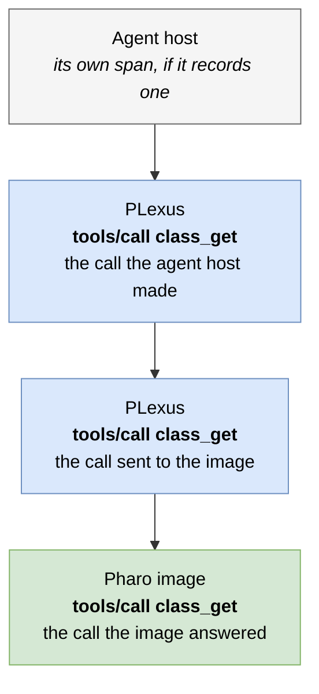

When an AI agent works in Pharo through our tools, most of what happens is out of sight. The agent host shows the name of a tool and its answer, and little else. Which calls were slow? Which failed, and why? Did a call go through PLexus to the right image?

[Pharo MCP](/posts/pharo-mcp/) and [PLexus](/posts/plexus/) can answer these questions. They can record every tool call with [OpenTelemetry](https://opentelemetry.io), and send these records to a backend of your choice. This is off until you turn it on.

This post explains what the tools record, how they follow OpenTelemetry's conventions for AI programs, what they leave out by default, and how to turn it on.

## Telemetry, observability, OpenTelemetry

Three words that are easy to mix up:

- **Telemetry** is the data a program sends about its own work. It comes in three main kinds, called *signals*: **traces**, which follow one operation from start to end; **metrics**, which count and measure; and **logs**, which record events.
- **Observability** is what telemetry is for: being able to tell what a system does, and why, from the outside, without changing its code or stopping it.
- **OpenTelemetry** is an open standard for telemetry, a project of the [Cloud Native Computing Foundation](https://www.cncf.io/projects/opentelemetry/). It defines an API and libraries in many languages, a protocol to send the data (OTLP), and shared names for what is recorded. Every OpenTelemetry backend reads the same protocol, so the program that records does not choose the backend: you do.

A trace is made of **spans**. A span is one operation: its name, when it started, how long it took, how it ended, and some **attributes**, which are named values like `gen_ai.tool.name: class_get`. A span can have a parent, so the spans of one trace form a tree.

## What the tools record

Each tool call is one trace. When the agent calls an image's tool through PLexus, the trace holds three spans of ours:



The trace stays one tree because each side passes the *trace context*, a short id of the trace and of the current span, inside the request it sends. PLexus reads it from the agent host's request, when the host sends one, and passes it on to the image.

Each span says:

- which tool was called, and the names of the arguments the agent gave, but not their values unless you turn that on;
- how the call ended and, when it failed, how: an unknown tool, an argument that does not fit the tool's schema, an error the tool reported;
- the size of the request and of the answer, and whether the answer was cut because it was too long;
- which of our tools made the span, its version, and the Pharo version.

PLexus also records a span when it creates, starts, stops or deletes an image. And each image counts its calls in metrics too, such as how long they take.

[MCP's](https://github.com/Evref-BL/MCP/blob/main/docs/user/observability.md) and [PLexus's](https://github.com/Evref-BL/PLexus/blob/main/docs/observability.md) observability guides list every attribute.

## Built on OpenTelemetry's conventions for AI

The tools do not use a format of their own. Their spans are plain OpenTelemetry spans, and most of their attributes have names from OpenTelemetry's **semantic conventions**: shared names, so that an attribute means the same thing whatever program recorded it. `service.name`, `os.type` and `error.type` are such names, used by programs of every kind.

### The conventions for AI

For AI programs, OpenTelemetry has a project of its own, [Generative AI Observability](https://github.com/open-telemetry/community/blob/5125996b5d159ff9aaa906f9a25226a821dc7bed/projects/gen-ai.md), which extends an earlier one, the LLM Semantic Conventions project. Many companies build tools to watch AI programs, and each used to record them its own way. The project gives them one place to agree, so that the way to record an AI program belongs to no single vendor. Its members come from Microsoft, IBM, Elastic, Traceloop, OpenLIT and Langtrace, among others.

Its [GenAI semantic conventions](https://github.com/open-telemetry/semantic-conventions-genai) say how to record a call to a model, the steps of an agent, a tool call, and a call through MCP. They are still marked *Development*: they change often, and we follow them in our releases.

### What our tools follow

Pharo MCP and PLexus record each tool call as the [conventions for MCP](https://github.com/open-telemetry/semantic-conventions-genai/blob/7cb940f24dea/docs/gen-ai/mcp.md) say:

| The conventions for MCP | Our tools |
| --- | --- |
| The span is named after the method and the tool | `tools/call class_get` |
| The side that answers makes a *server* span, the side that asks a *client* span | PLexus: a server span for the host's call, a client span for the call it sends to the image. The image: a server span |
| The method, the tool and the operation: `mcp.method.name`, `gen_ai.tool.name`, and `gen_ai.operation.name` set to `execute_tool` | Always |
| The protocol version, the session and the transport: `mcp.protocol.version`, `mcp.session.id`, `network.transport` | When known |
| How the call failed, in `error.type`: `tool_error` when the tool reports an error, else the JSON-RPC error's code, which `rpc.status_code` holds too. Each side judges from its own: a server's span does not count a request it could not serve because of the caller, such as a request it cannot parse, as its error, while the client's span does | Always |
| The trace context travels inside the request, in its `_meta`, so that the span of the side that answers is the child of the one that asks | PLexus reads it from the agent host, and passes it to the image |

What the conventions do not cover is ours, under our own prefixes, `pharo.mcp.` and `plexus.`: the names of the arguments, the sizes, whether an answer was cut. The prefixes keep our attributes apart from any name the conventions add later.

## Values stay out by default

By default, the attributes hold names, never values: no argument, no answer, no source code, no stack, no file path, no image or project name. A name the agent chose, like the name of a tool that does not exist, is recorded only when it reads as an identifier.

Where the conventions ask for more, the tools record it:

- The request's id on the span of each side, and the address and port of the image on PLexus's span of the call it sends there.
- When a JSON-RPC error fails a span, that error's message as its status description: the message the caller got.
- The tool's arguments and its answer, only when you turn them on with the conventions' own setting, `OTEL_INSTRUMENTATION_GENAI_CAPTURE_CONTENT=SPAN_ONLY`.

What is kept is then up to whoever collects the spans: a collector can drop any attribute, and the status's description, before the spans are stored or leave your machine.

## What it brings

- **Any backend can read the spans.** A backend that knows the GenAI conventions shows our spans as tool calls, with nothing to adapt, beside the spans of other AI programs.
- **One trace, from the agent to the image.** When an agent host records its own work and passes its trace context, as the conventions ask, our spans join its trace: the host's steps, then PLexus, then the image, in one tree.
- **Data that others can use.** Spans named this way can be compared with those of other MCP servers that follow the same conventions, and read by people who never saw our code.
- **Attributes that anyone can check.** The conventions are written in the open, by people from many companies, and each name has a public definition. You do not have to take our word for what an attribute means.
- **A place to give back.** The project welcomes contributors. What we record and the conventions do not cover yet, like the names of the arguments an agent gave, without their values, is what we can bring to it.

## Turning it on

The tools read the standard `OTEL_*` settings of OpenTelemetry. They send nothing until a setting says where to send.

### With the pharo-agent plugin or PLexus

Write the settings in PLexus's settings file, `~/.config/plexus/otel.env` (`%APPDATA%\plexus\otel.env` on Windows), then restart your agent host. For a backend on your machine:

```sh
OTEL_EXPORTER_OTLP_ENDPOINT=http://localhost:4318
OTEL_EXPORTER_OTLP_PROTOCOL=http/json
```

PLexus then traces the calls it serves, and passes the settings on to the images it starts. The images it creates from then on load MCP's `Telemetry` group, so they record their calls too. The first create after this is slower, because it prepares a new base with the group. `image_list` says which images record their calls, and why not.

The settings in this file replace the `OTEL_*` settings the agent host passes down, so the host's own telemetry settings do not send PLexus's spans elsewhere.

To also record the tool's arguments and its answer, add `OTEL_INSTRUMENTATION_GENAI_CAPTURE_CONTENT=SPAN_ONLY` to the same file.

### With Pharo MCP alone

In your own image:

1. Load MCP's `Telemetry` group, from the same repository you loaded MCP from: the same `baseline: 'MCP'; repository: ...` as before, with `load: #( 'Telemetry' )`.
2. Evaluate `MCP useOpenTelemetryObservabilityByDefault`, then save the image.
3. Write the settings above in MCP's settings file, `~/.config/pharo-mcp/otel.env` (`%APPDATA%\pharo-mcp\otel.env` on Windows). The image reads them each time it starts.

### A backend to look at the traces

Any backend that receives OTLP works: an [OpenTelemetry Collector](https://opentelemetry.io/docs/collector/), [Jaeger](https://www.jaegertracing.io), [Grafana Tempo](https://grafana.com/oss/tempo/), or a hosted service. To try it on your machine, Jaeger runs in one command, and shows the traces at `http://localhost:16686`:

```sh
docker run --rm -p 16686:16686 -p 4318:4318 jaegertracing/jaeger:2.23.0
```

Keep the backend, or a collector in front of it, on the same machine: an image looks up a host name on its only thread, so a slow name server would hold the whole image while it sends.

### Collecting the spans of others

To learn how agents use the tools beyond your own machine, you need the spans of other people, with their consent. [pharo-agent-telemetry](https://github.com/Evref-BL/pharo-agent-telemetry) is what anyone needs to host such an opt-in study of their own. You write the study's data: which attributes it keeps, what it is for, who answers for it. From that data, it generates the filter of a small agent, the configuration of a collector, and the page participants read, so the three cannot disagree. Participants see what would be sent before they join, and join and leave with one command each. Joining installs the agent on their machine, which keeps only the attributes on the study's list before anything leaves it, and points the tools at it. The collector applies the same rules again.

## Read more

- [MCP's observability guide](https://github.com/Evref-BL/MCP/blob/main/docs/user/observability.md): every attribute and metric of an image, and how its settings are read.
- [PLexus's observability guide](https://github.com/Evref-BL/PLexus/blob/main/docs/observability.md): every span of PLexus, and its settings.
- [pharo-agent-telemetry](https://github.com/Evref-BL/pharo-agent-telemetry): what you need to host your own opt-in study of the tools, from the participants' commands to the collector.
- [Generative AI Observability](https://github.com/open-telemetry/community/blob/5125996b5d159ff9aaa906f9a25226a821dc7bed/projects/gen-ai.md): the OpenTelemetry project.
- [OpenTelemetry's conventions for MCP](https://github.com/open-telemetry/semantic-conventions-genai/blob/7cb940f24dea/docs/gen-ai/mcp.md).
