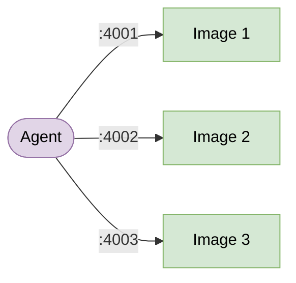
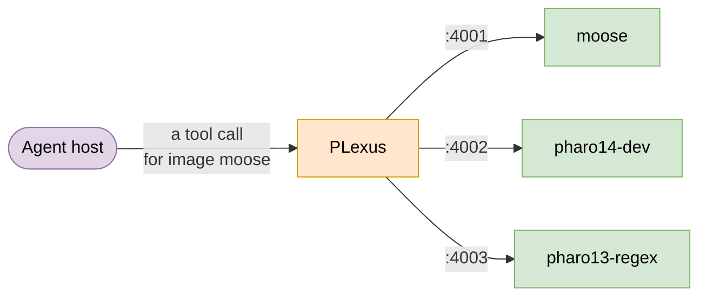
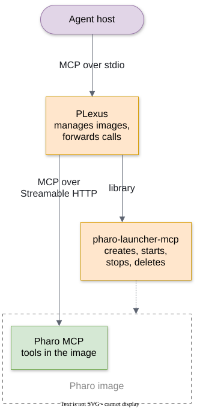

The [first post](/posts/pharo-mcp/) of this series presented Pharo MCP, a server that runs inside a Pharo image and lets an AI agent work in it: search the code, change it through Pharo's compiler and refactorings, run the tests. Each image runs its own server, which the agent host connects to on a port.

That covers one agent working in one image. [PLexus](https://github.com/Evref-BL/PLexus) gives an agent as many images as it needs, and lets it create and remove them on its own. This post explains why that matters and how PLexus works.

## Why one image is not enough

An image is one shared world. Everything in it, every class, every method and every open window, is shared by whoever works in it. Agents working on different projects can share an image, but two agents that change the same code get in each other's way: one compiles a method while the other runs the tests that it breaks. And an agent that changes what the others run on, such as Pharo's kernel, SUnit or Pharo MCP itself, can break every agent in the image.

An agent may need several images:

- **Subagents.** Some agent hosts, such as Claude Code, can split a task between subagents that run in parallel. Each subagent that changes code needs an image of its own.
- **Separate subjects.** A bug fix and a feature can each get an image of their own, as they each get a branch of their own.
- **Experiments.** An agent can try a risky change in a fresh image, and delete it afterwards. Your own image stays as it was.
- **Different setups.** Tasks can need different images: a Moose image, another Pharo version, a project with a native library loaded.

Pharo MCP already allows several images at once, since each image runs its own server on its own port:



But each of those images has to be set up by hand. Someone creates the image, loads Pharo MCP into it, picks a free port, starts the server, and declares that port to the agent host. Then, at the end of the task, someone stops and deletes the image, and removes it from the host's configuration. For images that only live as long as a task, that is a lot of work, and the agent cannot do any of it itself.

## What PLexus does

PLexus has two jobs.

**It manages images.** It lists the templates an image can be made from, and creates, starts, stops, deletes and lists images. An image it creates from a template already holds Pharo MCP, and starting an image answers once that server does.

**It forwards tool calls.** PLexus is itself an MCP server, the only one the agent host needs to know. Its tool list holds its own tools for managing images, followed by the tools that each running image lists. Each image's tool gets one more argument, `image`, which names the image the call is for. PLexus finds where that image's server listens and passes the call on:



The agent names images, never ports: only PLexus knows where each image's server listens. When only one image runs, it may even leave the name out. And when the agent starts, stops or deletes an image, PLexus sends the host `notifications/tools/list_changed`, a notification that the [protocol defines](https://modelcontextprotocol.io/specification/2026-07-28/server/tools#list-changed-notification) for when a server's tools change. A host that handles it lists the tools again, so the image's tools appear or go away during the session.

So the agent can do the whole cycle on its own: create an image for its task, start it, work in it with the image's tools, and stop and delete it when the task is done.

## From the agent to the image

Here is how the pieces fit together, from the agent down to the images:



- The **agent host** launches PLexus as a subprocess, and exchanges MCP messages with it through its standard input and output (stdio).
- **PLexus** decides what to do: manage an image itself, or forward a call to one.
- **[pharo-launcher-mcp](https://github.com/Evref-BL/pharo-launcher-mcp)**, a library PLexus uses, drives [Pharo Launcher](https://pharo-project.github.io/pharo-launcher/): its templates, its virtual machines, and the processes that run images.
- **Pharo MCP**, inside each running image, answers the calls PLexus forwards to it, over Streamable HTTP.

## How PLexus works

A few design choices shape how PLexus behaves.

**Images come from Pharo Launcher's templates.** The same templates you see in Pharo Launcher, the official Pharo versions, Moose and others, are the ones PLexus offers. The first time an image is created from a template, PLexus builds a **base**: the template with the Pharo MCP release that PLexus pins, loaded and saved. So the first create is slow. Later creates from the same template, with the same Pharo MCP release, copy that base and are fast, as if served from a cache. From the command line or the library, an image can instead be built by a script of your own, for example to load Pharo MCP from your own checkout.

**PLexus remembers nothing that can change behind its back.** An image is a directory, and it exists as long as that directory does. A running image is a process, and it runs as long as that process does. Each time it is asked, PLexus looks at the directories and at the running processes, rather than at a record it kept. So an answer is never older than the call that gave it: if you stop an image yourself, or if it crashes, the next call sees it.

**Each project sees its own images.** Here, a project is the directory you start the agent host in, usually the checkout of the repository you work on. The host gives that directory to PLexus when it starts it, and the directory's name becomes the **scope** of the project's images. Two projects can each have an image called `dev`: they are different images, and neither project sees the other's. Two directories with the same name, though, share their images.

**Stopping does not save, unless asked.** A stopped image starts again as it was last saved. To keep the work done in an image, the agent asks the stop to save it.

**PLexus forwards the image's tools without knowing them.** It passes on whatever each image lists, as it is. An image with an older or newer Pharo MCP, or with your own project's tools, is served all the same, and a tool that Pharo MCP adds or changes needs no change in PLexus. The one tool PLexus calls itself is the image's `evaluate` tool, to ask an image to quit, or to save and quit, when it stops it.

## Three ways to use it

PLexus is a [Node.js](https://nodejs.org/) package, [`@evref-bl/plexus`](https://www.npmjs.com/package/@evref-bl/plexus), which you can use in three ways:

- **As an MCP server for an agent host**, with `plexus mcp`. The host starts it and passes the project's directory:

  ```json
  { "mcpServers": { "plexus": { "command": "plexus", "args": ["mcp", "--project", "/path/to/MyProject"] } } }
  ```

  Each agent host has its own configuration format; this one is Claude Code's.
- **As a command line**, with `plexus image create`, `start`, `stop` and the others, whose results are JSON, for your own scripts.
- **As a library**, in a Node.js program of your own.

You need Node.js and Pharo Launcher installed. The [README](https://github.com/Evref-BL/PLexus#readme) gives the versions, and the [commands page](https://github.com/Evref-BL/PLexus/blob/main/docs/commands.md) every command and what each one answers.

If you use Claude Code or Codex, you do not need to set PLexus up yourself: the next post presents [the pharo-agent plugin](/posts/pharo-agent-plugin/), which installs PLexus along with everything else in one step.

## Learn more

- [PLexus on GitHub](https://github.com/Evref-BL/PLexus), with its README and documentation
- [pharo-launcher-mcp on GitHub](https://github.com/Evref-BL/pharo-launcher-mcp)
- [Pharo Launcher](https://pharo-project.github.io/pharo-launcher/)
- The first post of this series: [Pharo MCP](/posts/pharo-mcp/)
