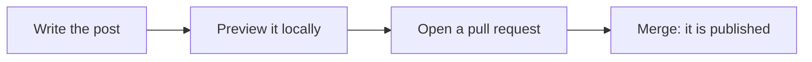

A post is a Markdown file in [`src/content/posts/`](https://github.com/Evref-BL/evref-bl.github.io/tree/main/src/content/posts) of the site's repository. Its file name is its address: `moose-rules.md` is published at `/posts/moose-rules/`.

## The frontmatter

```yaml
---
title: Writing rules with the Moose Rule Engine
description: One or two sentences saying what the reader gets from this post.
date: 2026-11-20
kind: guide # guide, experiment, project or news
tags: [moose, rules] # lowercase, words joined by hyphens
authors: [gabriel-darbord] # keys from src/content/authors.yaml
---
```

Every list on the site shows the title and the description, so write the description for someone deciding whether to open the post.

The build checks the frontmatter, and fails on a missing description, an unknown author or kind, or a tag like `Moose Rules` instead of `moose-rules`.

Optional fields:

- `updated: 2026-12-01` when a guide changes in a way readers should know about.
- `draft: true` keeps a post off the published site; it still shows on your local server.
- `cover` and `coverAlt` give the post an image, from a file next to it.
- `series` and `part` put the post in a series, which links its parts in order. A series is declared once in `src/content/series.yaml`, with a title and a description.

A new author adds themselves to `src/content/authors.yaml`:

```yaml
jane-doe:
  name: Jane Doe
  github: jane-doe
```

## Code and diagrams

Code blocks are highlighted from their language, Smalltalk included:

```st
MRERule subclass: #MyRule
	instanceVariableNames: ''
	classVariableNames: ''
	package: 'My-Rules'
```

A `mermaid` code block is drawn as a diagram. Its `accTitle:` line names it, for screen readers and in the post's contents beside the text, as an image's alt text does up to its first colon:



A diagram that Mermaid lays out badly can be drawn in [draw.io](https://www.drawio.com/) instead, and saved as a `.drawio.svg` file. It is linked like an image, ``, and drawn inside the page. Its lines and labels follow the site's theme when they use the light theme's colours: `#5c6370` for lines, `#1d2026` for text and `#ffffff` behind labels. Export it with draw.io's light theme, into the same file, which stays editable in draw.io:

```sh
draw.io -x -e -t --theme light --embed-svg-fonts false -b 4 -o diagram.drawio.svg diagram.drawio.svg
```

A post that needs components or interactive parts can be an `.mdx` file instead.

## Citing

A post cites a paper, a book or a specification by its key in [`src/content/references.bib`](https://github.com/Evref-BL/evref-bl.github.io/blob/main/src/content/references.bib), the site's one bibliography. Add the work there first, exported from Zotero, DBLP or its publisher with its DOI, then cite it in brackets:

| You write | The reader sees |
| --- | --- |
| `[@purdom1972]` | [1] |
| `[@jls-se25, §15.10.1]` | [2, §15.10.1] |
| `[@purdom1972; @laemmel2001]` | [1, 3] |

Works are numbered in the order the post first cites them. Each number links to the post's references, listed under a "References" heading at its end in IEEE style, and shows the full reference when hovered. A key the bibliography lacks fails the build. The Markdown served to agents carries the same numbers and references.

Keep links for what a reader clicks through to, such as a repository or a tool's documentation, and cite what a claim rests on: a paper, a standard, a specification at the revision you read.

## Preview and publish

```sh
npm install
npm run dev
```

The site is then at `http://localhost:4321`, and reloads as you edit. Open a pull request: its checks build the site and follow every link in it, and merging it publishes the post.
